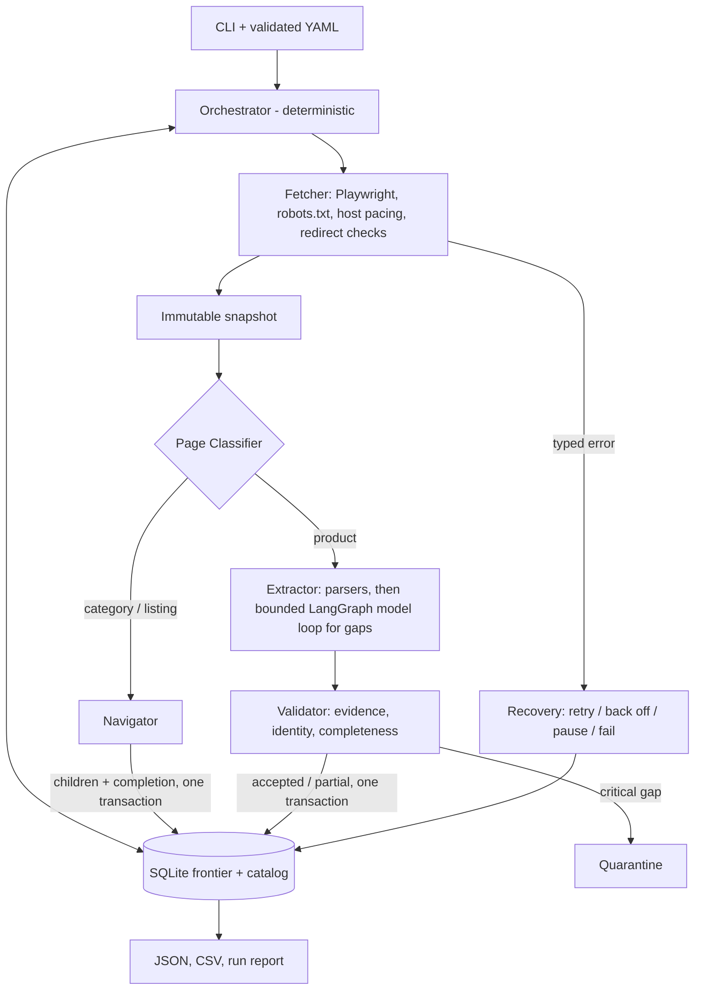

# CatalogAgent

Agent-based catalog extraction POC for Safco Dental Supply (Dental Exam Gloves; Sutures & Surgical
Products). Design: [docs/](docs/README.md). What was built and measured, milestone by milestone:
[docs/implementation-log.md](docs/implementation-log.md).

## 1. Overview and results at a glance

Measured on the live site, run `run_20261127_full` (2026-11-27, hybrid mode with `claude-haiku-5-5`, config
[`configs/safco_full_sample.yaml`](configs/safco_full_sample.yaml): the default config with every discoverable
product of both categories and the P1 model features switched on; 435 s):

| | Result |
|---|---|
| Products exported | **89, all `accepted`**, 0 partial, 0 quarantined: every product reachable from the two category roots (39 gloves, 50 sutures & surgical) |
| Subcategory coverage | all 14 subcategories: gloves (chloroprene 10, latex 12, nitrile 12, surgical 3, vinyl 1, glove holder 1); sutures & surgical (bone grafting 12, surgical blades 12, surgical medicaments 10, IV fluids 5, sutures 5, periodontal dressings 3, cold packs 2, suture needles 1) |
| Variants (SKUs) | **556** (193 gloves, 363 sutures & surgical); every SKU observed on each page was exported (556/556) |
| Price check | every page's SKU set equals its JSON-LD SKU set (89/89); all 556 exported prices equal the page's own JSON-LD offer price, 0 disagree; 386 SKUs come from the rendered table, 170 from JSON-LD on the 16 pages whose table never rendered |
| Alternatives | 712 from the rendered "Trending Products" carousel, `source: trending_carousel`, product itself excluded |
| Evidence | every exported SKU, price and availability carries an evidence ref to its row (556 each), plus 484 pack and the attribute refs |
| Pages fetched | 106 of a 250-page budget (1 discovery, 16 listings, 89 product pages), 0 retries; run `COMPLETED` / `FRONTIER_DRAINED` |
| Duplicate SKU identities | 1 of 555 distinct SKUs (0.2%): `4180087` is listed on two different suture product pages by the site itself; both records keep it |
| LLM usage | 114 model calls, all attribute splitting (89 pages); 0 classifier fallback (no `unknown` page), 0 repair suggestion (no selector failure); 400,364 input / 95,445 output tokens ≈ $0.088 at list price |
| What the model added | structured variant attributes on 446/556 variants; SKU, price, pack and availability identical to the deterministic parser on the same snapshots (0 differences) |
| Offline evaluation (FR-13) | 22 frozen pages, 4 hybrid runs: SKU recall 1.0 and price accuracy 1.0 in both modes; held-out attribute recall 0 → 0.54–1.0 with the model (see §9) |
| Why an LLM (§9) | normal pages and redesigns that keep the page's data: rules get every visible row, no model needed; a synthetic redesign that removes all structured data: rules 0 / 82 visible rows, rules + LLM 82 / 82 with price and stock, 0 wrong values |
| Tests | 78 passed (P0 + P1 suites, offline), smoke script passed |

Outputs: [`outputs/products.json`](outputs/products.json), [`outputs/variants.csv`](outputs/variants.csv),
[`outputs/catalog_sample.sql`](outputs/catalog_sample.sql) (SQLite dump, §6), [`outputs/summary.md`](outputs/summary.md),
[`outputs/run_report.json`](outputs/run_report.json), [`outputs/failed_tasks.json`](outputs/failed_tasks.json),
[`outputs/repair_suggestions.json`](outputs/repair_suggestions.json), [`outputs/evaluation_report.json`](outputs/evaluation_report.json),
[`outputs/redesign_experiment.json`](outputs/redesign_experiment.json).

## 2. Architecture overview



One Python process per database, two async workers, one shared host pacer. Code: `src/catalog_agent/`
(`adapters/safco.py` holds every Safco-specific selector and URL rule).

## 3. Why this approach

- **Deterministic orchestrator, rule-first agents** (ADR-01/02): the crawl workflow is known in
  advance; the model is used only to resolve a detected gap in one product page.
- **Playwright only** (ADR-04): listings render client-side via Algolia on a third-party host; there is no
  permitted first-party JSON endpoint, so no HTTPX path was added.
- **Evidence for SKU and price** (ADR-06): every exported SKU and price carries a reference to a
  section/row of the saved snapshot; the Validator re-derives the sections from the HTML and requires
  exact cell equality in the same row.
- **SQLite frontier with an OS lock** (ADR-05): crash recovery and atomic task transitions with no
  infrastructure.
- **LangGraph for the Extractor loop** (ADR-09), behind the `ExtractorAgent` interface.
- **Robots-respecting pagination** (ADR-11, new): `?page=N` is disallowed by robots.txt, so it is
  detected and recorded, not fetched.

## 4. Agent responsibilities

| Agent | Decides | Model |
|---|---|---|
| Navigator (`agents/navigator.py`) | roots to seed (`selected`/`all`), in-scope subcategories and products, pagination stop | never |
| Page Classifier (`agents/classifier.py`) | category / listing / product / other / blocked / unknown | P1, off by default: one call for `unknown` pages, accepted only if the type's DOM signals are present |
| Extractor (`agents/extractor.py`) | product + variant candidate | bounded loop for recoverable gaps (`hybrid` mode) |
| Validator & Deduplicator (`agents/validator.py`) | accept / partial / quarantine, evidence verification | never |
| Recovery (`agents/recovery.py`) | retry with backoff, honor Retry-After, pause on 401/403/CAPTCHA, fail | P1, off by default: selector-repair suggestions tested with `test_selector`, report only |

All return `AgentResult` (`contracts.py`); none writes to storage.

**Where the model is and is not used.** The requirements suggest four LLM uses; this is what each became:

| Suggested use | Here | Default | How to see it |
|---|---|---|---|
| Extraction fallback for irregular layouts | Extractor loop: recovers a page whose rules found no variant (generic rows + row mapping, §9), and splits variant labels into attributes | on in `--mode hybrid` | any hybrid run; §9 redesign experiment |
| Page type detection | Classifier fallback for `unknown` pages, accepted only if the proposed type's DOM signals are present | off (`agents.classifier.llm_fallback_enabled`) | on in `configs/safco_full_sample.yaml`; `test_classifier_fallback.py` |
| Selector repair suggestions | Recovery proposes replacement selectors after repeated field failures, tests them with `test_selector` on failing and control pages, writes `repair_suggestions.json`; never applied automatically | off (`agents.recovery.repair_suggestions_enabled`) | on in `configs/safco_full_sample.yaml`; `test_repair_suggestions.py` |
| Reasoning over navigation | deliberately **not** used: navigation stays rule-bound so a model can never widen the crawl scope, and validation stays independent of the model (constitution §III) | n/a | n/a |

The two P1 features ship off because on the current site they rarely trigger (no `unknown` page and no selector
failure in the latest runs), and turning them on only adds model calls; they are the insurance for a layout
change, like the extraction fallback.

## 5. Setup and execution

Requires macOS or Linux, [uv](https://docs.astral.sh/uv/) and `make`. **One command** (tested 2026-11-27):

```bash
git clone https://github.com/Bruce-Yu-1203/CatalogAgent.git && cd CatalogAgent
make demo           # setup, live bounded crawl of both categories, export, run report, summary tables
make demo-offline   # the same pipeline on saved fixtures: no network, no credentials
```

`make demo` writes `outputs/demo/` (`products.json`, `variants.csv`, `run_report.json`,
`failed_tasks.json`, `summary.md`) and prints the summary: pages fetched, accepted/partial/quarantined,
model calls, tokens and list cost, run time, then the data-quality tables of §11. It uses `--mode hybrid` with
the model from `.env`; without credentials it still completes deterministically and reports
`MODEL_UNAVAILABLE`, or run `make demo MODE=deterministic`. `make demo-offline` writes to `data/demo_offline/`; it
replays the saved fixtures in `tests/fixtures/live/` (4 product pages, 25 SKUs), and the product links it finds
without a saved page are recorded as `NOT_FOUND` failures, so its status is `COMPLETED_WITH_ERRORS` by design.
Measured `make demo` on 2026-11-27 (`demo_20261127`): 37 pages, 20 products all accepted, 87 SKUs, 27 model
calls ≈ $0.017, 151 s.

The individual commands, as tested on 2026-11-26:

```bash
git clone https://github.com/Bruce-Yu-1203/CatalogAgent.git && cd CatalogAgent
uv sync
uv run playwright install chromium
uv run catalog-agent crawl --config configs/safco.yaml --mode deterministic
uv run catalog-agent export --format all          # latest run -> outputs/products.json, outputs/variants.csv
uv run catalog-agent report                        # -> outputs/run_report.json, outputs/failed_tasks.json
uv run catalog-agent resume --run-id RUN_ID        # after a crash, PAUSED or time limit
uv run catalog-agent resume --run-id RUN_ID --add-pages 50 --add-model-calls 20 --add-products 5   # after BUDGET_EXHAUSTED
uv run pytest
./scripts/smoke.sh                                 # lint, tests, offline replay of the README commands
```

Hybrid mode (`--mode hybrid`, the CLI default) needs `LLM_PROVIDER=anthropic`, `LLM_MODEL`, `LLM_API_KEY`
in `.env` (see `.env.example`). Without them a hybrid run still works and reports `MODEL_UNAVAILABLE`
degraded recovery. Offline replay of saved fixtures: add `--replay tests/fixtures/live --db /tmp/x.db`.

## 6. Output schema and samples

The schema is [PRD §5](docs/01-prd.md#5-catalog-data-contract): products with nested variants in
`products.json`, one row per variant in `variants.csv` (33 columns, in PRD order), with evidence refs,
`llm_fields` and `missing` reasons. All 89 records in `outputs/` come from the single run
`run_20261127_full`. Example (abridged, real):

```json
{"name": "Safco Nitrilex Surpass Gloves", "product_key": "DRCCS", "brand": "Safco",
 "category_paths": [["Dental Supplies", "Dental Exam Gloves"], ["Dental Supplies", "Dental Exam Gloves", "Nitrile gloves"]],
 "variants": [{"sku": "1027990", "variant_name": "X-small, 300/box", "pack_quantity": 300, "pack_unit": "box",
   "price": "15.99", "currency": "USD", "availability": "in_stock",
   "evidence": [{"field": "sku", "section_id": "variant-table", "row_id": "row-1", "raw_value": "1027990", "method": "deterministic"},
                {"field": "price", "section_id": "variant-table", "row_id": "row-1", "raw_value": "$15.99", "normalized_value": "15.99", "method": "deterministic"}]}]}
```

**Query the data.** Every run is stored in SQLite (`data/catalog.db`, tables `crawl_runs`, `crawl_tasks`,
`products`, `variants`; schema in [`schema.sql`](src/catalog_agent/storage/schema.sql)).
[`outputs/catalog_sample.sql`](outputs/catalog_sample.sql) is a dump of the products and variants of the sample
run, so the queries below work without crawling (after a crawl, run them on `data/catalog.db` with
`WHERE run_id = '...'`):

```bash
sqlite3 sample.db < outputs/catalog_sample.sql
```

```sql
-- products and SKUs per category
SELECT replace(root, 'https://www.safcodental.com/catalog/', '') AS category,
       count(*) AS products, sum(variant_count) AS skus
FROM products GROUP BY root;
-- gloves 39 / 193, sutures-surgical-products 50 / 363

-- variants that are not in stock (77: Backorder, Special order, Direct from manufacturer)
SELECT p.name, v.sku, v.availability_raw, v.price
FROM variants v JOIN products p USING (run_id, product_id)
WHERE v.availability <> 'in_stock' ORDER BY p.name;

-- where a SKU's price came from: the evidence row in the saved page
SELECT v.sku, v.price, json_extract(e.value, '$.field') AS field,
       json_extract(e.value, '$.section_id') AS section, json_extract(e.value, '$.raw_value') AS raw_value
FROM variants v, json_each(v.evidence_json) e
WHERE v.sku = '1027990' AND json_extract(e.value, '$.field') IN ('sku', 'price');
-- 1027990  15.99  sku    variant-table  1027990
-- 1027990  15.99  price  variant-table  $15.99
```

## 7. Production-minded controls

One subsection per production item, in the order the requirements list them. Each says how it is done and
where to check it.

### 7.1 Rate limiting
One per-host pacer allows a request at most every 2 s plus jitter (`request_interval_seconds`); two workers
share it, a 429 widens the interval, and images, fonts and third-party analytics are blocked (only the Adobe
recommendations service for the "Trending Products" carousel is allowed). robots.txt is enforced on every URL
and redirect.
*Code:* `runtime/fetcher.py` (`HostPacer`, `check_url`), `runtime/robots.py`. *Tests:*
`test_runtime.py::test_429_honors_retry_after_then_succeeds`, `test_discovery.py::test_robots_wildcards_match_live_rules`,
`test_discovery.py::test_fetcher_rejects_disallowed_and_off_host_urls_without_requesting`.

### 7.2 Retries
Transient failures (timeout, connection, 5xx, incomplete render) retry up to `max_attempts: 3` with exponential
backoff and jitter; Retry-After is honored; retry times are stored, so they survive a restart.
*Code:* `agents/recovery.py`, `storage/repository.py` (`RETRY_WAIT`). *Tests:*
`test_runtime.py::test_backoff_is_bounded_exponential_with_jitter`,
`test_runtime.py::test_transient_errors_retry_with_bounded_attempts`.

### 7.3 Error handling
Every failure gets a typed error code and a decision from the Recovery agent: retry, fail (404, robots,
off-host redirect, unsupported page), or pause the run on 401/403/CAPTCHA without any bypass. Unverifiable data
is quarantined or kept null with a reason; model errors degrade to the deterministic result (§8).
*Code:* `contracts.py` (`ErrorCode`), `agents/recovery.py`, `runtime/orchestrator.py`, `agents/validator.py`.
*Tests:* `test_runtime.py::test_403_pauses_the_scope_without_bypass`,
`test_runtime.py::test_captcha_page_is_treated_as_restriction`,
`test_extraction.py::test_conflicting_prices_for_one_sku_are_quarantined_not_silently_merged`,
`test_agent_loop.py::test_model_error_degrades_and_keeps_verified_fields`.

### 7.4 Resumability / checkpointing
The SQLite frontier is the checkpoint: every task state change commits immediately. `resume --run-id` takes the
`fcntl.flock` lock (a second process fails fast), requeues interrupted tasks, keeps completed ones, and uses the
run's stored configuration; page and model budgets are cumulative, and a budget-exhausted run continues only
with `--add-*` flags.
*Code:* `runtime/runner.py`, `runtime/lock.py`, `storage/repository.py` (`reconcile_running`). *Tests:*
`test_persistence.py::test_interrupt_and_resume_recovers_running_tasks_only_after_lock`,
`test_persistence.py::test_second_process_on_the_same_database_fails_fast`,
`test_runtime.py::test_page_budget_and_resume_semantics`,
`test_runtime.py::test_time_limit_pauses_and_plain_resume_continues`.

### 7.5 Logging
Structured JSON lines to stderr and `data/logs/<run_id>.jsonl`, each with `run_id`, `task_id`, `agent`, `event`,
`outcome` and `duration_ms`; model events add model ID, tool names and token usage. Every run also writes
`run_report.json` with the quality metrics.
*Code:* `telemetry.py`, `quality.py`. *Test:*
`test_runtime.py::test_logs_are_structured_json_and_secret_like_fields_are_redacted`.

### 7.6 Deduplication
URLs are canonicalized and each task is unique per run (`run_id`, `task_key`), so a product linked from several
listings is fetched once and keeps every category path. Repeated variant rows are merged when consistent and
quarantined when they conflict; the run report counts SKUs that appear under two products (0 in every run).
*Code:* `extraction/normalize.py` (`canonicalize_url`), `storage/repository.py` (`_enqueue`),
`agents/validator.py`. *Tests:* `test_discovery.py::test_listing_schedules_in_scope_children_once_with_hierarchy`,
`test_extraction.py::test_consistent_duplicate_rows_are_merged_once`,
`test_adversarial.py::test_two_page_cursor_cycle_terminates_through_task_dedup`.

### 7.7 Idempotency
`product_id` and `variant_id` are stable hashes; products and variants are upserted by `(run_id, id)`; a task's
children and its completion, and a product's rows and its completion, each commit in one transaction, so
replaying a task changes nothing and a crash never leaves half a result.
*Code:* `contracts.py` (`product_id_for`, `variant_id_for`), `storage/repository.py`. *Tests:*
`test_persistence.py::test_same_task_twice_keeps_unique_counts`,
`test_persistence.py::test_failure_before_commit_leaves_nothing_partially_committed`,
`test_persistence.py::test_navigation_children_and_completion_commit_together`,
`test_persistence.py::test_same_product_in_two_runs_keeps_separate_rows`.

### 7.8 Config-driven execution
`configs/safco.yaml` sets roots, scope (`selected`/`all`), rate, retries, budgets, model limits, P1 switches and
storage paths, validated by Pydantic; the CLI adds only run options (`--mode`, `--replay`, `--sitemap-sample`).
Site-specific selectors live only in `adapters/safco.py`.
*Code:* `config.py`, `configs/safco.yaml`, `cli.py`. *Tests:*
`test_discovery.py::test_selected_seeds_exactly_the_two_configured_roots`,
`test_discovery.py::test_all_seeds_every_permitted_root_on_the_saved_navigation_snapshot`,
`test_runtime.py::test_page_budget_and_resume_semantics` (edited YAML does not change a running run).

### 7.9 Secrets management
Model credentials come only from the environment or a git-ignored `.env` (`.env.example` lists names only);
nothing secret is in config or code, secret-like log fields are redacted, and without credentials a hybrid run
still completes in degraded mode.
*Code:* `config.py` (`Secrets`), `extraction/llm.py`, `telemetry.py`, `.gitignore`. *Tests:*
`test_runtime.py::test_logs_are_structured_json_and_secret_like_fields_are_redacted`,
`test_runtime.py::test_hybrid_run_without_credentials_degrades_instead_of_failing`.

### 7.10 Deployment path
Today: a local CLI with SQLite and a snapshot folder. Next: the same code in a Docker image on the Playwright base,
run as a scheduled container job with PostgreSQL, object storage and a secrets manager; then queue-based workers
when a second source is added. Not built; the staged plan with triggers is in
[Architecture §9](docs/03-overall-architecture.md#9-deployment-path). *Check now:* `./scripts/smoke.sh` runs the
documented setup and commands end to end offline.

## 8. Failure handling

| Failure | Handling (tested in `tests/test_runtime.py`) |
|---|---|
| Timeout, connection, 5xx, incomplete render | retry with backoff; a product page with JSON-LD is accepted without the table; final attempt accepts any page |
| 429 | wait at least Retry-After, slow the host |
| 401/403/CAPTCHA text | pause the run (`PAUSED` / `ACCESS_RESTRICTED`), task kept resumable, never bypassed |
| 404, robots-disallowed, off-host redirect, unsupported page | terminal failure, recorded |
| Variant table not rendered | after the readiness wait, JSON-LD variant rows are the evidence source; recorded as `table_not_rendered`, not a selector failure (16 of 89 pages in the current run) |
| Model error / missing key / no progress / budget | loop stops; verified fields kept; record `partial` |
| SKU with conflicting rows, no verifiable variants | quarantined |
| Crash mid-run | requeue after lock; reserved budget of the interrupted attempt stays consumed |

## 9. Where AI adds value (measured)

### Why an LLM

Rules handle the normal pages; the LLM is insurance for the worst case, a redesign that breaks every rule. The
measure is **the variant rows a visitor can see on the page**: on the 30 product pages below that is 82 rows
(the other 142 SKUs of these products exist only in JSON-LD and inline script data, because the table never
rendered or rendered fewer rows; no method can read a row the page does not show).

| Situation (same 30 pages) | Rules only | Rules + LLM | Recovered by the LLM |
|---|---|---|---|
| ① Normal page | 82 / 82 visible rows (224 / 224 SKUs incl. JSON-LD) | same | 0: not needed |
| ② Redesign that keeps the page's data (JSON-LD or inline script data) | 82 / 82 visible rows (203 / 224 SKUs) | same | 0: not needed |
| ③ Redesign that removes all structured data | **0 / 82** | **82 / 82** (81 / 82 in one variant, see below) | **all visible rows**, with price, stock and name; 0 wrong values |

- **① and ②: rules carry normal operation.** The LLM never supplies a SKU, price or stock value there. In hybrid
  mode it only splits variant labels into attributes (`C-6, chromic gut, 4-0, 18"` → Needle / Material / Size /
  Length), which `attribute_gaps: false` turns off.
- **③: the LLM keeps the data flowing on the day of a redesign.** A rules-only crawler drops to zero until someone
  rewrites the selectors; with the LLM every visible row is recovered, each value checked against the text of its
  own row, at about $0.0012 per page (≈ $5 for all 3,980 product pages in that worst case).
- **Limit:** data the page does not display cannot be recovered after a redesign that also drops JSON-LD and
  inline data. Redesigns usually keep JSON-LD, because search engines use it; then situation ② applies.

How it was measured: `uv run catalog-agent experiment --run-id run_20261127_sitemap30_merge_hybrid --redesigns
data,classes,tags,columns` replays the 30 saved product pages of live run `run_20261127_sitemap30_merge_hybrid`
(a random sitemap sample, 18 top-level categories) on the original pages and on **synthetic** redesigns of them
→ [`outputs/redesign_experiment.json`](outputs/redesign_experiment.json). Every redesign removes the JSON-LD and
renames every class name, so every Safco selector fails. Situation ② keeps the inline script data (`data`);
situation ③ also removes it and was run in three variants:

| Situation ③ variant | Rules only | Rules + LLM | Accepted / partial | Wrong prices / wrong SKUs | Model calls / cost |
|---|---|---|---|---|---|
| Class names renamed | 0 / 82 | 82 / 82 | 23 / 7 | 0 / 0 | 56 / $0.036 |
| Element types changed too (div → section, span → em, ul → ol) | 0 / 82 | 81 / 82 | 22 / 8 | 0 / 0 | 56 / $0.035 |
| Columns reordered too (children of repeated elements reversed) | 0 / 82 | 82 / 82 | 23 / 7 | 0 / 0 | 55 / $0.036 |

The 7 partial records in each row are the pages that render no rows (nothing to recover); the extra one with
changed element types is a single-variant page where the model returned no usable answer. Model calls include the
attribute splitting that also runs on normal pages (42 calls, $0.034 on the original pages). Reference SKUs and
prices come from the original page's JSON-LD.

Details:
- **Situation ①: three rule sources.** The parser merges the rendered table, the JSON-LD and the inline
  page data, in that order of priority; a later source only fills SKUs the earlier ones did not show (so a
  "Non-purchasable" table row keeps its null price). On this sample rules-only went from 27/30 accepted and
  209/224 SKUs (`run_20261127_sitemap30`, before the merge) to 30/30 and 224/224, where the earlier hybrid run
  needed the model (29/30, 218/224). Live re-runs on the same 30 products, `run_20261127_sitemap30_merge` (rules)
  and `run_20261127_sitemap30_merge_hybrid` (rules + LLM), both give 30 accepted and 224/224 SKUs.
- **Situation ②: inline page data, read by rules (203/224 SKUs, no model).** Inline product
  objects are found by shape (an `sku` string plus a numeric price), not by variable name. On 50 normal pages
  this found 290 SKUs, all equal to the JSON-LD SKUs with equal prices. The 21 SKUs it cannot give are
  personalized items whose inline objects carry no price (11) and SKUs missing from the inline data (10).

How redesign recovery works (no new agent, no full-text matching):
1. **Generic evidence rows.** When the table, JSON-LD and inline data yield nothing, `build_sections` builds
   `page-rows` from repeated sibling elements (same tag and class signature, whatever the names are) that each
   show a `$` price and an SKU-like code; a page with one variant uses the single smallest element showing
   both. A product page with no parsed variant but such rows raises a `no_variants` gap; without such rows there
   is no gap and no model call.
2. **Column labels from the page.** If a header row (same tag, no price, short labels) precedes the rows, the
   code aligns its labels to the row's columns, so cell keys read `Item # k012402`, `Mfr # k6713ba`,
   `Stock Availability k483504`.
3. **Row mapping.** The model sees 3 sample rows and the row count, and answers which cell holds the item number,
   the variant label and the stock status. The code applies that mapping to every row (falling back to the same
   labelled column when one row's markup differs, e.g. "Backorder" styled unlike "In stock"): one call per page.
4. **Same evidence gate as everywhere.** Each mapped row is verified on its own: the SKU must equal a whole
   SKU-like cell of that row, the price must equal that row's first displayed price, the stock must equal a whole
   cell that reads as a stock status (a known status, or a short text in the stock column such as "Special
   order"). A generic-row record is `accepted` only if every generic row got a verified variant.

What went wrong on the way, measured on the same pages:
- Before steps 2–3 the model copied rows by hand: 56/82 SKUs with classes renamed; the 20-row page failed.
- With columns reordered and no column labels, the model took the manufacturer number (`Mfr #`) for the SKU on 6
  pages (9–10 SKUs). Those codes are whole cells of the right row, so the evidence gate alone could not catch
  this; the column labels (step 2) fixed it.
- Stock first reached only 49–55 of 82: rows styled differently per status got different cell keys, so the model
  left stock out, and "Special order" was not accepted as a status. The labelled-column fallback and the stock
  column rule fixed both (82/82 with classes renamed).

Still not recoverable: SKUs that exist only in JSON-LD or inline data when a redesign drops both (142 of 224 here;
real redesigns usually keep JSON-LD because search engines use it), and occasional model failures (one call with
no usable answer), which leave the record `partial`, never wrong.

The fake-model tests (`tests/test_agent_loop.py`) cover: rules reading inline data after a `data` redesign with
no model call; a valid row mapping applied by code to all rows in one call, with stock; a stock column that is not
a status rejected; mappings to the label column, the price cell or another section rejected; a single-variant
page getting one generic row; a SKU on the wrong row, the row's second price or an invented SKU rejected; a
redesigned page without prices building no generic rows and never calling the model.

### Two-category live run

**Current live run** (`run_20261127_full`, the source of `outputs/`), hybrid output compared with the
deterministic parser re-run on **the same saved snapshots**:

| | Deterministic | Hybrid (Claude Haiku 5.5, effort `low`) |
|---|---|---|
| SKUs / prices exported | 556 / 556 | 556 / 556, identical values (0 differences in price, pack, availability) |
| Variants with structured attributes (beyond the table group heading) | 0 / 556 | 446 / 556 |
| Model calls / tokens / list cost | 0 | 114 calls, 496k tokens, ≈ $0.088 |
| Records accepted | 89 / 89 | 89 / 89 |

The deterministic parsers already resolve every critical field on Safco (SKU, price, pack, stock), so the
model's value here is splitting variant labels like `C-3, chromic gut, 5-0, 18", 12/box` into
`Needle / Material / Size / Length`. Every attribute value is checked to appear in its own row (and carries
an evidence ref); keys are not standardized across products. A manual check of 20 random hybrid variants in an
earlier run found 17 correct, 1 wrong (`Scent: Hygiene` for an oral rinse) and 2 with a debatable key.

The output varies between runs on the same site: the earlier live runs `run_20261127_hybrid2` and
`run_20261127_alts` got attributes on 90/91 and 80/91 variants. The offline evaluation below measures this on
frozen pages.

### Offline evaluation (FR-13)

`uv run catalog-agent evaluate --mode compare` runs both modes on the same 22 frozen pages
(`tests/fixtures/eval/`: 21 real pages, 17 of them held out from development, plus one labelled synthetic page
with a variant row removed). SKU/price labels come from each page's JSON-LD; attribute labels were written by
Claude from the visible variant labels, not reviewed by a human, and attribute keys are not scored.

| Held-out real pages (17) | Deterministic | Hybrid run 1 | Hybrid run 2 | Hybrid run 3 | Hybrid run 4 (`outputs/evaluation_report.json`) |
|---|---|---|---|---|---|
| Variant recall / precision | 1.0 / 1.0 | 1.0 / 1.0 | 1.0 / 1.0 | 1.0 / 1.0 | 1.0 / 1.0 |
| Price accuracy | 1.0 | 1.0 | 1.0 | 1.0 | 1.0 |
| Attribute value recall | 0.0 | 1.0 | 0.54 | 0.96 | 0.75 |
| Attribute value precision | n/a | 0.99 | 0.99 | 0.99 | 0.99 |
| Model calls / cost | 0 / $0 | 18 / $0.012 | 20 / $0.011 | 22 / $0.014 | 23 / $0.014 |

Runs 2 and 3 followed prompt changes: run 2 added the missing-variant price instruction and showed the
variance problem (one 18-variant page used its 3 calls without submitting); run 3 sends attribute gaps 8 SKUs per
turn. Run 4 uses the JSON-LD merge described above. On the synthetic page (one table row removed) the
deterministic parser missed the SKU in runs 1–3 (recall 0.8) and the model recovered it in runs 2 and 3; since the
merge, rules fill it from JSON-LD (recall 1.0, `accepted`, no model call needed for it). The model adds no value on SKU or price for these pages; its value is attribute structure, with
noticeable run-to-run variance.

The scripted-fake tests in `tests/test_agent_loop.py` and `tests/test_adversarial.py` cover the rejection paths
(SKU or price outside its cited row, overwrites, invented SKUs, instruction-following output, malformed patches)
and the typed-feedback retry.

## 10. Scaling to full-site crawling

**Full coverage is not yet proven.** What has been measured so far:

| Root | Products the listing reports | Unique products discovered (page 1 of root + subcategory listings) | Not reachable |
|---|---|---|---|
| Dental Exam Gloves | 92 | 39 | 53 (nitrile 61 and latex 16 exceed one 12-item page) |
| Sutures & Surgical Products | 56 | 50 | 6 (bone grafting 14, blades & scalpels 15) |

The listing traversal cannot close this gap: robots.txt disallows `?page=N`, and `scope: all` only adds more
roots, each with the same page-1 limit. The permitted alternative is the product sitemap advertised in
robots.txt. A single fetch of `products.xml` on 2026-11-27 returned **3,980 product URLs** (with `lastmod`),
and **all 89 products discovered from the listings are in it** (0 missing). The sitemap has no category
information, so seeding a full crawl from it means fetching every product page and reading its breadcrumb or
JSON-LD `category`; not built yet. What remains to prove full coverage: seed product tasks from the sitemap,
crawl the two categories' share, and report expected (listing totals) vs found vs missing.

**Extraction outside the two categories (sitemap sample).** `crawl --sitemap-sample 30 --sample-seed 20261127`
seeded 30 random products from `products.xml` (18 different top-level categories, from restoratives and burs
to endodontics, orthodontics and patient giveaways) and ran the same pipeline, with no Safco code changed for
it. Output: [`outputs/sitemap_sample/`](outputs/sitemap_sample/).

| Same 30 pages | Deterministic, before the JSON-LD merge (`run_20261127_sitemap30`) | Hybrid, before (`run_20261127_sitemap30_hybrid`) | Deterministic, after (`run_20261127_sitemap30_merge`) | Hybrid, after (`run_20261127_sitemap30_merge_hybrid`) |
|---|---|---|---|---|
| Records | 27 accepted, 3 partial | 29 accepted, 1 partial | 30 accepted | 30 accepted |
| SKUs exported / observed on the pages | 209 / 224 | 218 / 224 | 224 / 224 | 224 / 224 |
| Fetches, retries, time | 30, 0, 97 s | 30, 0, 147 s | 30, 0, 107 s | 30, 0, 163 s |
| Model calls / list cost | 0 | 40 / ≈ $0.027 | 0 | 48 / ≈ $0.033, all attribute splitting |

Before the merge, 3 pages rendered fewer table rows than their JSON-LD lists (15 SKUs) and only the model could
add them (9 of 15 in the live run). The rules now fill them from JSON-LD, so the model is no longer needed for
any SKU on this sample (§9). `outputs/sitemap_sample/` is the after-merge hybrid run. The sample also surfaced templates the two categories did not show (pages with no variant table,
and "No options of this product are available"); they are now render notes, not selector failures. This is
evidence that extraction generalizes across categories and that the sitemap is a usable discovery path; it is
not evidence of complete coverage.

`scope: all` seeds every root found on `/catalog` (20 roots, unit-tested against the saved snapshot) and runs
the identical traversal; it was **not** run against the live site. Sizing with measured inputs: ≈ 4.1 s per
page fetch (435 s / 106 fetches in the current run, two workers sharing a 2 s pacer, 0 retries, model calls
included), so crawling all 3,980 sitemap products would take about 3,980 × 4.1 s ≈ 4.5 h on one worker; the binding limit is the polite
request rate, not compute. `lastmod` allows incremental recrawls. Budgets (`max_pages`,
`max_products_per_category`, `max_model_calls_per_run`, `max_invocation_seconds`) bound any run and a budget
stop leaves resumable work. Deployment path: [Architecture §9](docs/03-overall-architecture.md#9-deployment-path).

**Selector self-repair at scale (design only, not implemented).** At full-site scale the LLM fallback of §9
(generic rows) should stay a short-term bridge, because it costs a model call per page for as long as the
layout stays changed. The intended loop: when the share of product pages whose variants come from the
`page-rows` fallback (or that hit `no_variants`) rises above a threshold for one template, the existing
repair-suggestion agent (FR-12, report-only today) proposes replacement selectors, tests them with
`test_selector` against the failing pages and against control pages whose LLM-recovered SKUs and prices passed
the evidence gate, and opens a reviewed change to `adapters/safco.py`. A canary crawl must reproduce the
evidence-verified values before the change is rolled out; after that, normal pages go back to zero model calls.
Nothing is changed automatically.

## 11. Data-quality monitoring

The POC writes the [§10.1 metrics](docs/03-overall-architecture.md#101-poc-run-metrics-implemented-reported-in-run_reportjson)
per category into `run_report.json`: field fill rates, validation failure, quarantine, LLM fallback and
evidence rejection rates, duplicate identity count and the missing-reason distribution. Production
monitoring with drift alerts ([§10.2](docs/03-overall-architecture.md#102-production-monitoring-design-only))
is design only. `uv run catalog-agent summary --run-id RUN_ID` renders these metrics as the tables below,
adding the issue-code distribution (validator/extractor issues by severity and code), the count of values
rejected by evidence checks, and the duplicate rate. Measured on the sample run `run_20261127_full`
([`outputs/summary.md`](outputs/summary.md); the `make demo` run is in [`outputs/demo/summary.md`](outputs/demo/summary.md)):

| Pages fetched | Product pages | Accepted / partial / quarantined | Products / SKUs exported | Model calls | Tokens in / out | List cost | Time |
|---|---|---|---|---|---|---|---|
| 106 | 89 | 89 / 0 / 0 | 89 / 556 | 114 | 400,364 / 95,445 | $0.088 | 434.7 s |

| Field completeness | gloves | sutures-surgical-products |
|---|---|---|
| product.name | 100% | 100% |
| product.brand | 100% | 100% |
| product.manufacturer | 0% | 0% |
| product.description | 100% | 100% |
| product.category_paths | 100% | 100% |
| product.image_urls | 100% | 100% |
| product.attributes | 62% | 2% |
| product.alternatives | 100% | 100% |
| variant.sku | 100% | 100% |
| variant.variant_name | 100% | 100% |
| variant.attributes | 100% | 74% |
| variant.pack_label | 98% | 81% |
| variant.pack_quantity | 98% | 81% |
| variant.pack_unit | 98% | 81% |
| variant.price | 100% | 100% |
| variant.currency | 100% | 100% |
| variant.availability_raw | 100% | 100% |

| Missing-value and rejection reasons | gloves | sutures-surgical-products |
|---|---|---|
| missing manufacturer: not_applicable | 39 | 50 |
| missing variants.pack_label: not_visible | 3 | 69 |
| missing variants.pack_quantity: parse_failed | 0 | 1 |
| rejected values (evidence checks) | 0 | 0 |
| evidence rejection rate (model patches) | 0% | 2% |

Duplicates: SKU identity duplicate rate 0.2% (1 SKUs under more than one product); 0 repeated rows merged with identical values.

Reading the table: manufacturer is `not_applicable` because Safco shows one label, used as brand; missing pack
sizes are labels that state no pack, mostly volumes and weights on sutures & surgical items (`not_visible`); the
Validator raised no issue on these 89 pages; the 2% evidence rejection rate is 6 model-proposed attribute values
that were not in their row and were dropped; the one duplicate identity is a SKU the site lists on two products.

## 12. Limitations

- Only page 1 of each listing is read (robots.txt disallows `?page=`): 39 of 92 gloves and 50 of 56 sutures &
  surgical products are reachable that way, and the sample run collected all 89. Full coverage of the 148
  listed products is not proven (see §10 for the sitemap path).
- Attribute values are verified only by appearing in their own row; key names can vary, ~1 in 20 sampled
  values was semantically wrong, and attribute recall varies between runs (0.54–1.0 held out).
- The classifier fallback never triggered on the live site (no `unknown` pages); it is tested only on
  real pages served at a synthetic URL. P1 model features are off in `configs/safco.yaml` and on in
  `configs/safco_full_sample.yaml`.
- Evaluation labels were produced by Claude, not a human; no held-out set beyond these 17 pages.
- In deterministic mode variant attributes are empty except for the table group heading.
- `alternatives` holds only the items the "Trending Products" carousel had rendered in the DOM when the page
  was captured (8 per page in the live runs); the carousel's arrows are never clicked, so items it would load
  later are not collected. The cards show no SKU, so `sku` is null. "Trending" is the site's merchandising
  list (for a suture page it lists other surgical items, for a bone graft other graft materials), not a
  verified substitute. "Best Value Options" is deliberately not collected: it cross-sells Safco private-label
  products of other types (e.g. prophy angles and curettes on a glove page), which are not alternatives.
- Pack size is parsed from `N/unit`, `Box of N` and `N-pack`; volume labels like `1cc jar` stay null with
  `not_visible` (sutures & surgical pack fill rate 81% in the current run).
- Some product pages (bone grafts, one trimmer) never render their variant table; their SKUs and prices
  come from the page's JSON-LD after one 15 s readiness wait.
- With the default budget (10 products per category) the budget is shared round-robin across subcategories
  (least-sampled first), so each subcategory gets one or two products.
- The generic redesign path (§9) needs rows that each show a `$` price and an SKU-like code (or exactly one such
  block on a single-variant page); SKUs that exist only in JSON-LD or inline data are not recoverable after a
  redesign that drops both. It was tested on four synthetic redesigns of saved pages, not on a real redesign or
  historical page versions.
- Manufacturer is always null (`not_applicable`): Safco shows one label, used as brand.
- Windows is not supported (`fcntl`).

## 13. Tests

`uv run pytest` on 2026-11-27: **78 passed**, all offline (saved fixtures, fake fetchers, fake models):
`test_discovery.py` 12, `test_extraction.py` 14, `test_agent_loop.py` 18, `test_persistence.py` 6, `test_runtime.py` 10
(P0) and `test_classifier_fallback.py` 6, `test_repair_suggestions.py` 7, `test_adversarial.py` 5 (P1).
`./scripts/smoke.sh` passed (lint, format check, tests, replay crawl → export → report → resume). Fixtures:
`tests/fixtures/live/` and `tests/fixtures/eval/` are real snapshots; synthetic variants are labelled.
