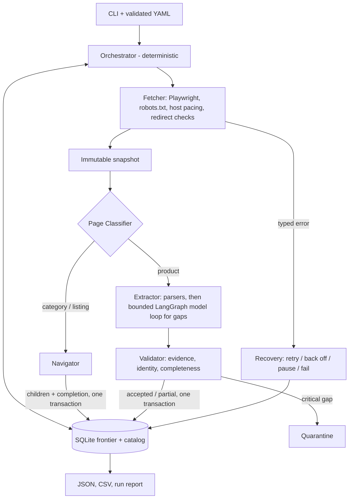

# CatalogAgent

Agent-based catalog extraction POC for Safco Dental Supply (Dental Exam Gloves; Sutures & Surgical
Products). Design: [docs/](docs/README.md). What was built and measured, milestone by milestone:
[docs/implementation-log.md](docs/implementation-log.md).

## 1. Overview and results at a glance

Measured on the live site, run `run_20261126_live` (2026-11-26, deterministic mode, 206 s):

| | Result |
|---|---|
| Products exported | 20 (10 gloves, 10 sutures & surgical), all `accepted`, 0 partial, 0 quarantined |
| Variants (SKUs) | 93 (53 gloves, 40 sutures & surgical); every SKU observed on each page was exported (93/93) |
| Price check | 64 table prices agree with the page's own JSON-LD offer price, 0 disagree; 29 prices came from JSON-LD because the table never rendered |
| Pages fetched | 48 of a 150-page budget (1 discovery, 16 listings, 31 product-page attempts incl. 10 render retries) |
| Stop | `BUDGET_EXHAUSTED` / `MAX_PRODUCTS_PER_CATEGORY` (10 per category configured); 69 tasks left resumable |
| Duplicate SKU identities | 0 |
| Tests | 37 passed (P0 suite, offline), smoke script passed |
| LLM usage in the live run | **none**: no model credentials were available, so the run used deterministic mode. The LLM path is implemented and tested only with scripted fake models. |

Outputs: [`outputs/products.json`](outputs/products.json), [`outputs/variants.csv`](outputs/variants.csv),
[`outputs/run_report.json`](outputs/run_report.json), [`outputs/failed_tasks.json`](outputs/failed_tasks.json).

## 2. Architecture overview



One Python process per database, two async workers, one shared host pacer. Code: `src/catalog_agent/`
(`adapters/safco.py` holds every Safco-specific selector and URL rule).

## 3. Why this approach

- **Deterministic orchestrator, rule-first agents** (ADR-01/02): the crawl workflow is known in
  advance; the model is used only to resolve a detected gap in one product page.
- **Playwright only** (ADR-04): listings render client-side via Algolia on a third-party host; there is no
  permitted first-party JSON endpoint, so no HTTPX path was added.
- **Evidence for SKU and price** (ADR-06): every exported SKU and price carries a reference to a
  section/row of the saved snapshot; the Validator re-derives the sections from the HTML and requires
  exact cell equality in the same row.
- **SQLite frontier with an OS lock** (ADR-05): crash recovery and atomic task transitions with no
  infrastructure.
- **LangGraph for the Extractor loop** (ADR-09), behind the `ExtractorAgent` interface.
- **Robots-respecting pagination** (ADR-11, new): `?page=N` is disallowed by robots.txt, so it is
  detected and recorded, not fetched.

## 4. Agent responsibilities

| Agent | Decides | Model |
|---|---|---|
| Navigator (`agents/navigator.py`) | roots to seed (`selected`/`all`), in-scope subcategories and products, pagination stop | never |
| Page Classifier (`agents/classifier.py`) | category / listing / product / other / blocked / unknown | never (P1 fallback not built) |
| Extractor (`agents/extractor.py`) | product + variant candidate | bounded loop for recoverable gaps (`hybrid` mode) |
| Validator & Deduplicator (`agents/validator.py`) | accept / partial / quarantine, evidence verification | never |
| Recovery (`agents/recovery.py`) | retry with backoff, honor Retry-After, pause on 401/403/CAPTCHA, fail | never (P1 repair suggestions not built) |

All return `AgentResult` (`contracts.py`); none writes to storage.

## 5. Setup and execution

Requires macOS or Linux, [uv](https://docs.astral.sh/uv/). Commands as tested on 2026-11-26:

```bash
uv sync
uv run playwright install chromium
uv run catalog-agent crawl --config configs/safco.yaml --mode deterministic
uv run catalog-agent export --format all          # latest run -> outputs/products.json, outputs/variants.csv
uv run catalog-agent report                        # -> outputs/run_report.json, outputs/failed_tasks.json
uv run catalog-agent resume --run-id RUN_ID        # after a crash, PAUSED or time limit
uv run catalog-agent resume --run-id RUN_ID --add-pages 50 --add-model-calls 20 --add-products 5   # after BUDGET_EXHAUSTED
uv run pytest
./scripts/smoke.sh                                 # lint, tests, offline replay of the README commands
```

Hybrid mode (`--mode hybrid`, the CLI default) needs `LLM_PROVIDER=anthropic`, `LLM_MODEL`, `LLM_API_KEY`
in `.env` (see `.env.example`). Without them a hybrid run still works and reports `MODEL_UNAVAILABLE`
degraded recovery. Offline replay of saved fixtures: add `--replay tests/fixtures/live --db /tmp/x.db`.

## 6. Output schema and samples

The schema is [PRD §5](docs/01-prd.md#5-catalog-data-contract): products with nested variants in
`products.json`, one row per variant in `variants.csv` (33 columns, in PRD order), with evidence refs,
`llm_fields` and `missing` reasons. All 20 records in `outputs/` come from the single run
`run_20261126_live`. Example (abridged, real):

```json
{"name": "Safco Nitrilex Surpass Gloves", "product_key": "DRCCS", "brand": "Safco",
 "category_paths": [["Dental Supplies", "Dental Exam Gloves"], ["Dental Supplies", "Dental Exam Gloves", "Nitrile gloves"]],
 "variants": [{"sku": "1027990", "variant_name": "X-small, 300/box", "pack_quantity": 300, "pack_unit": "box",
   "price": "15.99", "currency": "USD", "availability": "in_stock",
   "evidence": [{"field": "sku", "section_id": "variant-table", "row_id": "row-1", "raw_value": "1027990", "method": "deterministic"},
                {"field": "price", "section_id": "variant-table", "row_id": "row-1", "raw_value": "$15.99", "normalized_value": "15.99", "method": "deterministic"}]}]}
```

## 7. Production-minded controls

- **Rate limiting:** one host pacer, ≥ 2 s (+ jitter) between requests, concurrency 2; images, fonts and
  third-party analytics are blocked in the browser. Throttling (429) widens the interval.
- **Robots and scope:** robots.txt is fetched at start and enforced on every URL and redirect (with `*`/`$`
  wildcards); hosts are allow-listed; subcategories must sit under their root.
- **Retries:** bounded (`max_attempts: 3`), exponential backoff with jitter, Retry-After honored.
- **Resumability:** SQLite frontier; `fcntl.flock` lock held for the whole crawl/resume (a second process
  fails fast); interrupted RUNNING tasks are requeued only after the lock is acquired; resume uses the
  run's stored configuration.
- **Budgets** (Architecture §6.1): page and model calls are reserved in the database before dispatch;
  product limits per category; `BUDGET_EXHAUSTED` runs continue only with explicit `--add-*` flags,
  recorded in the run; `max_invocation_seconds` pauses the run.
- **Idempotency/dedup:** unique `(run_id, task_key)` tasks, upserts keyed by `(run_id, product_id)` and
  `(run_id, variant_id)`; IDs are stable hashes; a product found under two categories keeps both paths.
- **Atomicity:** children + parent completion, and product/variants + task completion, each in one
  transaction; no transaction is held across network or model I/O.
- **Logging:** JSON lines (`data/logs/<run_id>.jsonl`) with run, task, agent, event, outcome, duration.
- **Secrets:** environment only; `.env` is git-ignored; secret-like keys are redacted from logs.

## 8. Failure handling

| Failure | Handling (tested in `tests/test_runtime.py`) |
|---|---|
| Timeout, connection, 5xx, incomplete render | retry with backoff; final attempt accepts the page without the readiness signal |
| 429 | wait at least Retry-After, slow the host |
| 401/403/CAPTCHA text | pause the run (`PAUSED` / `ACCESS_RESTRICTED`), task kept resumable, never bypassed |
| 404, robots-disallowed, off-host redirect, unsupported page | terminal failure, recorded |
| Variant table not rendered | JSON-LD variant rows used as the evidence source (5 live products) |
| Model error / missing key / no progress / budget | loop stops; verified fields kept; record `partial` |
| SKU with conflicting rows, no verifiable variants | quarantined |
| Crash mid-run | requeue after lock; reserved budget of the interrupted attempt stays consumed |

## 9. Where AI adds value (measured)

Honest result: **not measured on live data.** No model credentials were available, so the live run is
deterministic. In that run the deterministic parsers resolved every critical field (93/93 SKUs and
prices verified). The only gap they leave on Safco pages is unstructured variant attribute text (e.g.
`C-3, chromic gut, 5-0, 18", 12/box`): variant attribute fill rate is 19% for gloves and 0% for sutures,
which is where the hybrid loop is meant to help. The loop is exercised in `tests/test_agent_loop.py`
with scripted fake models on a labeled synthetic gap (a real page with one table row removed): valid
patches are accepted with `llm` evidence and `llm_fields`; SKUs or prices not in their cited row,
overwrites of known values, invented SKUs and instruction-following output are rejected. The
baseline-vs-hybrid evaluation (P1, FR-13) was not built.

## 10. Scaling to full-site crawling

`scope: all` seeds every root found on `/catalog` (20 roots, unit-tested against the saved snapshot)
and then runs the identical traversal; it is bounded by `max_pages`, `max_products_per_category`,
`max_model_calls_per_run` and `max_invocation_seconds`, and a budget stop leaves resumable work. It was
**not** run against the live site and no multi-root traversal was verified end to end. Sizing with
measured inputs: ≈ 4.3 s per fetch attempt in this run (206 s / 48 attempts, two workers sharing a 2 s
pacer) and 10 render retries over 31 product-page attempts (32%), so a 6,300-page crawl would need about
6,300 × 1.32 ≈ 8,300 attempts × 4.3 s ≈ 10 h on one worker. The
render retries are the main cost and could be cut by accepting JSON-LD earlier. A full crawl also needs
a robots-compliant way past page 1 of each listing (sitemap `products.xml` is a candidate). Deployment
path: [Architecture §9](docs/03-overall-architecture.md#9-deployment-path).

## 11. Data-quality monitoring

The POC writes the [§10.1 metrics](docs/03-overall-architecture.md#101-poc-run-metrics-implemented-reported-in-run_reportjson)
per category into `run_report.json`: field fill rates, validation failure, quarantine, LLM fallback and
evidence rejection rates, duplicate identity count and the missing-reason distribution. Production
monitoring with drift alerts ([§10.2](docs/03-overall-architecture.md#102-production-monitoring-design-only))
is design only.

## 12. Limitations

- Only page 1 of each listing is read (robots.txt disallows `?page=`); 10 products per category were
  sampled; full coverage is not measured.
- LLM extraction was not demonstrated live (no credentials; A-07 unverified). P1 features (classifier
  fallback, repair suggestions, evaluation) are not built and are rejected by config validation if enabled.
- Variant attributes are mostly empty in deterministic mode (only the table group heading).
- Pack size is parsed only from `N/unit` tokens; labels like `Box of 20`, `5-pack` or `1cc jar` are left
  null with `not_visible`, which is imprecise (the text is visible but not in a supported form).
- Some variant names carry tooltip text (`… SDS | Details + - Contains: …`) from the description cell.
- Five bone-graft pages never rendered their variant table; their SKUs/prices come from JSON-LD and each
  cost two wasted readiness retries.
- Manufacturer is always null (`not_applicable`): Safco shows one label, used as brand.
- Windows is not supported (`fcntl`). The repository has not been pushed from this environment.

## 13. Tests

`uv run pytest` on 2026-11-26: **37 passed in 13.5 s**, all offline (saved fixtures, fake fetchers, fake
models): `test_discovery.py` 10, `test_extraction.py` 5, `test_agent_loop.py` 9, `test_persistence.py` 6,
`test_runtime.py` 7. `./scripts/smoke.sh` passed (lint, format check, tests, replay crawl → export →
report → resume). Fixtures: `tests/fixtures/live/` are real snapshots; synthetic variants are built in
the tests and labeled there.
