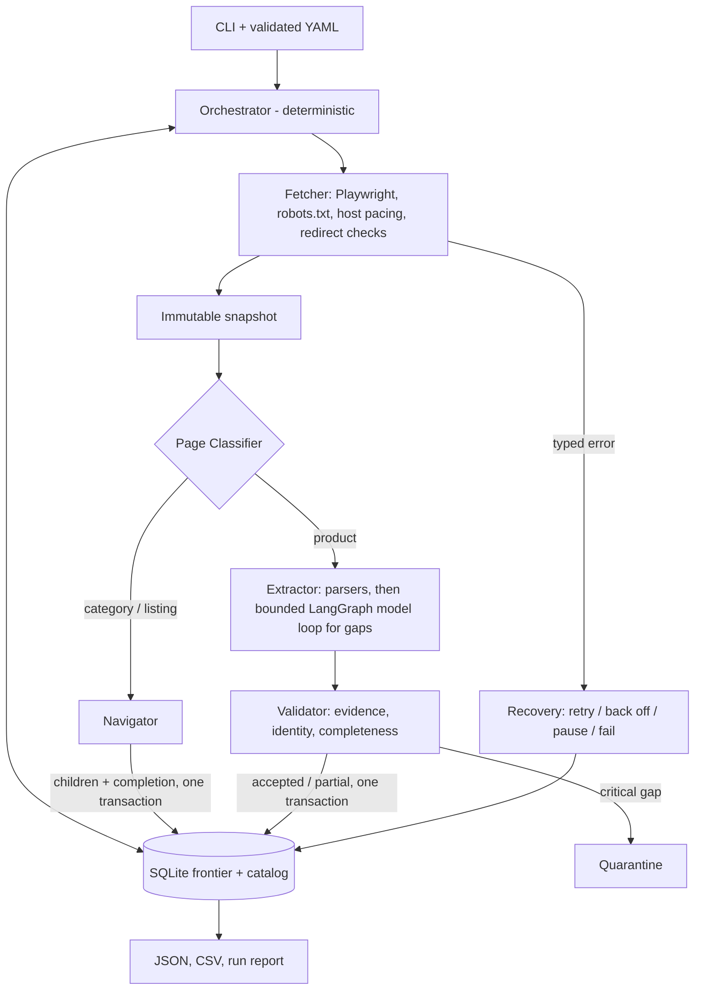

# CatalogAgent

Agent-based catalog extraction POC for Safco Dental Supply (Dental Exam Gloves; Sutures & Surgical
Products). Design: [docs/](docs/README.md). What was built and measured, milestone by milestone:
[docs/implementation-log.md](docs/implementation-log.md).

## 1. Overview and results at a glance

Measured on the live site, run `run_20261127_balanced` (2026-11-27, hybrid mode with `claude-haiku-5-5`,
classifier fallback and repair suggestions switched on, 131 s):

| | Result |
|---|---|
| Products exported | 20, all `accepted`, 0 partial, 0 quarantined |
| Subcategory coverage | every subcategory of both roots is sampled: gloves 10 (chloroprene 2, latex 2, nitrile 2, surgical 2, vinyl 1, glove holder 1); sutures & surgical 10 (all 8 subcategories, including Sutures: Safco SureStitch with 15 variants grouped by needle type) |
| Variants (SKUs) | 87 (51 gloves, 36 sutures & surgical); every SKU observed on each page was exported (87/87) |
| Price check | 78 table prices agree with the page's own JSON-LD offer price, 0 disagree; 8 prices came from JSON-LD because the table never rendered (3 pages); 1 variant shows "Non-purchasable" and no price, so its price is null (`not_visible`) although JSON-LD lists one |
| Alternatives | 160 (8 per product) from the rendered "Trending Products" carousel, `source: trending_carousel`, product itself excluded |
| Evidence | every exported SKU, price, availability, pack and attribute value carries an evidence ref to its row (87 SKU, 86 price, 87 availability, 75 pack, 197 attribute refs) |
| Pages fetched | 37 of a 150-page budget (1 discovery, 16 listings, 20 product pages), 0 retries |
| Stop | `BUDGET_EXHAUSTED` / `MAX_PRODUCTS_PER_CATEGORY` (10 per category configured); remaining products left resumable |
| Duplicate SKU identities | 0 |
| LLM usage | 24 model calls, all extraction (17 pages × 1, 2 pages × 2, 1 page × 3: attribute gaps go 8 SKUs per call), 0 repair suggestion, 0 classifier fallback; 57,129 input / 18,048 output tokens ≈ $0.015 at list price |
| What the model added | structured variant attributes on 87/87 variants (deterministic: 0/87 beyond the table group heading); SKU, price, pack and availability identical to deterministic extraction on the same snapshots (0 differences); recovery 20/20 pages |
| Repair suggestions | none: the 3 pages whose table never renders are recorded as the render note `table_not_rendered` (expected JSON-LD fallback), not as a selector failure |
| Offline evaluation (FR-13) | 22 frozen pages, 3 hybrid runs: SKU recall 1.0 and price accuracy 1.0 in both modes; held-out attribute recall 0 → 0.54–1.0 with the model (see §9) |
| Tests | 68 passed (P0 + P1 suites, offline), smoke script passed |

Outputs: [`outputs/products.json`](outputs/products.json), [`outputs/variants.csv`](outputs/variants.csv),
[`outputs/run_report.json`](outputs/run_report.json), [`outputs/failed_tasks.json`](outputs/failed_tasks.json),
[`outputs/repair_suggestions.json`](outputs/repair_suggestions.json), [`outputs/evaluation_report.json`](outputs/evaluation_report.json).

## 2. Architecture overview



One Python process per database, two async workers, one shared host pacer. Code: `src/catalog_agent/`
(`adapters/safco.py` holds every Safco-specific selector and URL rule).

## 3. Why this approach

- **Deterministic orchestrator, rule-first agents** (ADR-01/02): the crawl workflow is known in
  advance; the model is used only to resolve a detected gap in one product page.
- **Playwright only** (ADR-04): listings render client-side via Algolia on a third-party host; there is no
  permitted first-party JSON endpoint, so no HTTPX path was added.
- **Evidence for SKU and price** (ADR-06): every exported SKU and price carries a reference to a
  section/row of the saved snapshot; the Validator re-derives the sections from the HTML and requires
  exact cell equality in the same row.
- **SQLite frontier with an OS lock** (ADR-05): crash recovery and atomic task transitions with no
  infrastructure.
- **LangGraph for the Extractor loop** (ADR-09), behind the `ExtractorAgent` interface.
- **Robots-respecting pagination** (ADR-11, new): `?page=N` is disallowed by robots.txt, so it is
  detected and recorded, not fetched.

## 4. Agent responsibilities

| Agent | Decides | Model |
|---|---|---|
| Navigator (`agents/navigator.py`) | roots to seed (`selected`/`all`), in-scope subcategories and products, pagination stop | never |
| Page Classifier (`agents/classifier.py`) | category / listing / product / other / blocked / unknown | P1, off by default: one call for `unknown` pages, accepted only if the type's DOM signals are present |
| Extractor (`agents/extractor.py`) | product + variant candidate | bounded loop for recoverable gaps (`hybrid` mode) |
| Validator & Deduplicator (`agents/validator.py`) | accept / partial / quarantine, evidence verification | never |
| Recovery (`agents/recovery.py`) | retry with backoff, honor Retry-After, pause on 401/403/CAPTCHA, fail | P1, off by default: selector-repair suggestions tested with `test_selector`, report only |

All return `AgentResult` (`contracts.py`); none writes to storage.

## 5. Setup and execution

Requires macOS or Linux, [uv](https://docs.astral.sh/uv/). Commands as tested on 2026-11-26:

```bash
git clone https://github.com/Bruce-Yu-1203/CatalogAgent.git && cd CatalogAgent
uv sync
uv run playwright install chromium
uv run catalog-agent crawl --config configs/safco.yaml --mode deterministic
uv run catalog-agent export --format all          # latest run -> outputs/products.json, outputs/variants.csv
uv run catalog-agent report                        # -> outputs/run_report.json, outputs/failed_tasks.json
uv run catalog-agent resume --run-id RUN_ID        # after a crash, PAUSED or time limit
uv run catalog-agent resume --run-id RUN_ID --add-pages 50 --add-model-calls 20 --add-products 5   # after BUDGET_EXHAUSTED
uv run pytest
./scripts/smoke.sh                                 # lint, tests, offline replay of the README commands
```

Hybrid mode (`--mode hybrid`, the CLI default) needs `LLM_PROVIDER=anthropic`, `LLM_MODEL`, `LLM_API_KEY`
in `.env` (see `.env.example`). Without them a hybrid run still works and reports `MODEL_UNAVAILABLE`
degraded recovery. Offline replay of saved fixtures: add `--replay tests/fixtures/live --db /tmp/x.db`.

## 6. Output schema and samples

The schema is [PRD §5](docs/01-prd.md#5-catalog-data-contract): products with nested variants in
`products.json`, one row per variant in `variants.csv` (33 columns, in PRD order), with evidence refs,
`llm_fields` and `missing` reasons. All 20 records in `outputs/` come from the single run
`run_20261127_balanced`. Example (abridged, real):

```json
{"name": "Safco Nitrilex Surpass Gloves", "product_key": "DRCCS", "brand": "Safco",
 "category_paths": [["Dental Supplies", "Dental Exam Gloves"], ["Dental Supplies", "Dental Exam Gloves", "Nitrile gloves"]],
 "variants": [{"sku": "1027990", "variant_name": "X-small, 300/box", "pack_quantity": 300, "pack_unit": "box",
   "price": "15.99", "currency": "USD", "availability": "in_stock",
   "evidence": [{"field": "sku", "section_id": "variant-table", "row_id": "row-1", "raw_value": "1027990", "method": "deterministic"},
                {"field": "price", "section_id": "variant-table", "row_id": "row-1", "raw_value": "$15.99", "normalized_value": "15.99", "method": "deterministic"}]}]}
```

## 7. Production-minded controls

- **Rate limiting:** one host pacer, ≥ 2 s (+ jitter) between requests, concurrency 2; images, fonts and
  third-party analytics are blocked in the browser (only the Adobe recommendations service that renders the
  "Trending Products" carousel is allowed). Throttling (429) widens the interval.
- **Robots and scope:** robots.txt is fetched at start and enforced on every URL and redirect (with `*`/`$`
  wildcards); hosts are allow-listed; subcategories must sit under their root.
- **Retries:** bounded (`max_attempts: 3`), exponential backoff with jitter, Retry-After honored.
- **Resumability:** SQLite frontier; `fcntl.flock` lock held for the whole crawl/resume (a second process
  fails fast); interrupted RUNNING tasks are requeued only after the lock is acquired; resume uses the
  run's stored configuration.
- **Budgets** (Architecture §6.1): page and model calls are reserved in the database before dispatch;
  product limits per category; `BUDGET_EXHAUSTED` runs continue only with explicit `--add-*` flags,
  recorded in the run; `max_invocation_seconds` pauses the run.
- **Idempotency/dedup:** unique `(run_id, task_key)` tasks, upserts keyed by `(run_id, product_id)` and
  `(run_id, variant_id)`; IDs are stable hashes; a product found under two categories keeps both paths.
- **Atomicity:** children + parent completion, and product/variants + task completion, each in one
  transaction; no transaction is held across network or model I/O.
- **Logging:** JSON lines (`data/logs/<run_id>.jsonl`) with run, task, agent, event, outcome, duration.
- **Secrets:** environment only; `.env` is git-ignored; secret-like keys are redacted from logs.

## 8. Failure handling

| Failure | Handling (tested in `tests/test_runtime.py`) |
|---|---|
| Timeout, connection, 5xx, incomplete render | retry with backoff; a product page with JSON-LD is accepted without the table; final attempt accepts any page |
| 429 | wait at least Retry-After, slow the host |
| 401/403/CAPTCHA text | pause the run (`PAUSED` / `ACCESS_RESTRICTED`), task kept resumable, never bypassed |
| 404, robots-disallowed, off-host redirect, unsupported page | terminal failure, recorded |
| Variant table not rendered | after the readiness wait, JSON-LD variant rows are the evidence source; recorded as `table_not_rendered`, not a selector failure (3 pages in the current run, 6 in earlier samples) |
| Model error / missing key / no progress / budget | loop stops; verified fields kept; record `partial` |
| SKU with conflicting rows, no verifiable variants | quarantined |
| Crash mid-run | requeue after lock; reserved budget of the interrupted attempt stays consumed |

## 9. Where AI adds value (measured)

**Current live run** (`run_20261127_balanced`, the source of `outputs/`), hybrid output compared with the
deterministic parser re-run on **the same saved snapshots**:

| | Deterministic | Hybrid (Claude Haiku 5.5, effort `low`) |
|---|---|---|
| SKUs / prices exported | 87 / 86 | 87 / 86, identical values (0 differences in price, pack, availability) |
| Variants with structured attributes (beyond the table group heading) | 0 / 87 | 87 / 87 |
| Model calls / tokens / list cost | 0 | 24 calls, 75.2k tokens, ≈ $0.015 |
| Records accepted | 20 / 20 | 20 / 20 |

The deterministic parsers already resolve every critical field on Safco (SKU, price, pack, stock), so the
model's value here is splitting variant labels like `C-3, chromic gut, 5-0, 18", 12/box` into
`Needle / Material / Size / Length`. Every attribute value is checked to appear in its own row (and carries
an evidence ref); keys are not standardized across products. A manual check of 20 random hybrid variants in an
earlier run found 17 correct, 1 wrong (`Scent: Hygiene` for an oral rinse) and 2 with a debatable key.

The output varies between runs on the same site: the earlier live runs `run_20261127_hybrid2` and
`run_20261127_alts` got attributes on 90/91 and 80/91 variants. The offline evaluation below measures this on
frozen pages.

### Offline evaluation (FR-13)

`uv run catalog-agent evaluate --mode compare` runs both modes on the same 22 frozen pages
(`tests/fixtures/eval/`: 21 real pages, 17 of them held out from development, plus one labelled synthetic page
with a variant row removed). SKU/price labels come from each page's JSON-LD; attribute labels were written by
Claude from the visible variant labels, not reviewed by a human, and attribute keys are not scored.

| Held-out real pages (17) | Deterministic | Hybrid run 1 | Hybrid run 2 | Hybrid run 3 (`outputs/evaluation_report.json`) |
|---|---|---|---|---|
| Variant recall / precision | 1.0 / 1.0 | 1.0 / 1.0 | 1.0 / 1.0 | 1.0 / 1.0 |
| Price accuracy | 1.0 | 1.0 | 1.0 | 1.0 |
| Attribute value recall | 0.0 | 1.0 | 0.54 | 0.96 |
| Attribute value precision | n/a | 0.99 | 0.99 | 0.99 |
| Model calls / cost | 0 / $0 | 18 / $0.012 | 20 / $0.011 | 22 / $0.014 |

Runs 2 and 3 followed prompt changes: run 2 added the missing-variant price instruction and showed the
variance problem (one 18-variant page used its 3 calls without submitting); run 3 sends attribute gaps 8 SKUs per
turn. On the synthetic page the deterministic parser misses the removed SKU (recall 0.8, record `partial`);
hybrid recovered it with a verified JSON-LD price in runs 2 and 3 (`accepted`) but returned it without a price in
run 1 (`partial`). The model adds no value on SKU or price for these pages; its value is attribute structure, with
noticeable run-to-run variance.

The scripted-fake tests in `tests/test_agent_loop.py` and `tests/test_adversarial.py` cover the rejection paths
(SKU or price outside its cited row, overwrites, invented SKUs, instruction-following output, malformed patches)
and the typed-feedback retry.

## 10. Scaling to full-site crawling

**Full coverage is not yet proven.** What has been measured so far:

| Root | Products the listing reports | Unique products discovered (page 1 of root + subcategory listings) | Not reachable |
|---|---|---|---|
| Dental Exam Gloves | 92 | 39 | 53 (nitrile 61 and latex 16 exceed one 12-item page) |
| Sutures & Surgical Products | 56 | 50 | 6 (bone grafting 14, blades & scalpels 15) |

The listing traversal cannot close this gap: robots.txt disallows `?page=N`, and `scope: all` only adds more
roots, each with the same page-1 limit. The permitted alternative is the product sitemap advertised in
robots.txt. A single fetch of `products.xml` on 2026-11-27 returned **3,980 product URLs** (with `lastmod`),
and **all 89 products discovered in the current run are in it** (0 missing). The sitemap has no category
information, so seeding a full crawl from it means fetching every product page and reading its breadcrumb or
JSON-LD `category`; not built yet. What remains to prove full coverage: seed product tasks from the sitemap,
crawl the two categories' share, and report expected (listing totals) vs found vs missing.

`scope: all` seeds every root found on `/catalog` (20 roots, unit-tested against the saved snapshot) and runs
the identical traversal; it was **not** run against the live site. Sizing with measured inputs: ≈ 3.5 s per
page fetch (131 s / 37 fetches in the current run, two workers sharing a 2 s pacer, 0 retries), so crawling all
3,980 sitemap products would take about 3,980 × 3.5 s ≈ 3.9 h on one worker; the binding limit is the polite
request rate, not compute. `lastmod` allows incremental recrawls. Budgets (`max_pages`,
`max_products_per_category`, `max_model_calls_per_run`, `max_invocation_seconds`) bound any run and a budget
stop leaves resumable work. Deployment path: [Architecture §9](docs/03-overall-architecture.md#9-deployment-path).

## 11. Data-quality monitoring

The POC writes the [§10.1 metrics](docs/03-overall-architecture.md#101-poc-run-metrics-implemented-reported-in-run_reportjson)
per category into `run_report.json`: field fill rates, validation failure, quarantine, LLM fallback and
evidence rejection rates, duplicate identity count and the missing-reason distribution. Production
monitoring with drift alerts ([§10.2](docs/03-overall-architecture.md#102-production-monitoring-design-only))
is design only.

## 12. Limitations

- Only page 1 of each listing is read (robots.txt disallows `?page=`): 39 of 92 gloves and 50 of 56 sutures &
  surgical products are reachable that way; 10 products per category were sampled. Full coverage is not
  proven (see §10 for the sitemap path).
- Attribute values are verified only by appearing in their own row; key names can vary, ~1 in 20 sampled
  values was semantically wrong, and attribute recall varies between runs (0.54–1.0 held out).
- The classifier fallback never triggered on the live site (no `unknown` pages); it is tested only on
  real pages served at a synthetic URL. P1 model features are off in `configs/safco.yaml`.
- Evaluation labels were produced by Claude, not a human; no held-out set beyond these 17 pages.
- In deterministic mode variant attributes are empty except for the table group heading.
- `alternatives` holds only the items the "Trending Products" carousel had rendered in the DOM when the page
  was captured (8 per page in the live runs); the carousel's arrows are never clicked, so items it would load
  later are not collected. The cards show no SKU, so `sku` is null. "Trending" is the site's merchandising
  list (for a suture page it lists other surgical items, for a bone graft other graft materials), not a
  verified substitute. "Best Value Options" is deliberately not collected: it cross-sells Safco private-label
  products of other types (e.g. prophy angles and curettes on a glove page), which are not alternatives.
- Pack size is parsed from `N/unit`, `Box of N` and `N-pack`; volume labels like `1cc jar` stay null with
  `not_visible` (sutures & surgical pack fill rate 75% in the current run).
- Some product pages (bone grafts, one trimmer) never render their variant table; their SKUs and prices
  come from the page's JSON-LD after one 15 s readiness wait.
- The per-category budget is shared round-robin across subcategories (least-sampled first), so each
  subcategory gets one or two products; only page 1 of each listing is read.
- Manufacturer is always null (`not_applicable`): Safco shows one label, used as brand.
- Windows is not supported (`fcntl`).

## 13. Tests

`uv run pytest` on 2026-11-27: **68 passed**, all offline (saved fixtures, fake fetchers, fake models):
`test_discovery.py` 11, `test_extraction.py` 14, `test_agent_loop.py` 12, `test_persistence.py` 6, `test_runtime.py` 8
(P0) and `test_classifier_fallback.py` 6, `test_repair_suggestions.py` 6, `test_adversarial.py` 5 (P1).
`./scripts/smoke.sh` passed (lint, format check, tests, replay crawl → export → report → resume). Fixtures:
`tests/fixtures/live/` and `tests/fixtures/eval/` are real snapshots; synthetic variants are labelled.
