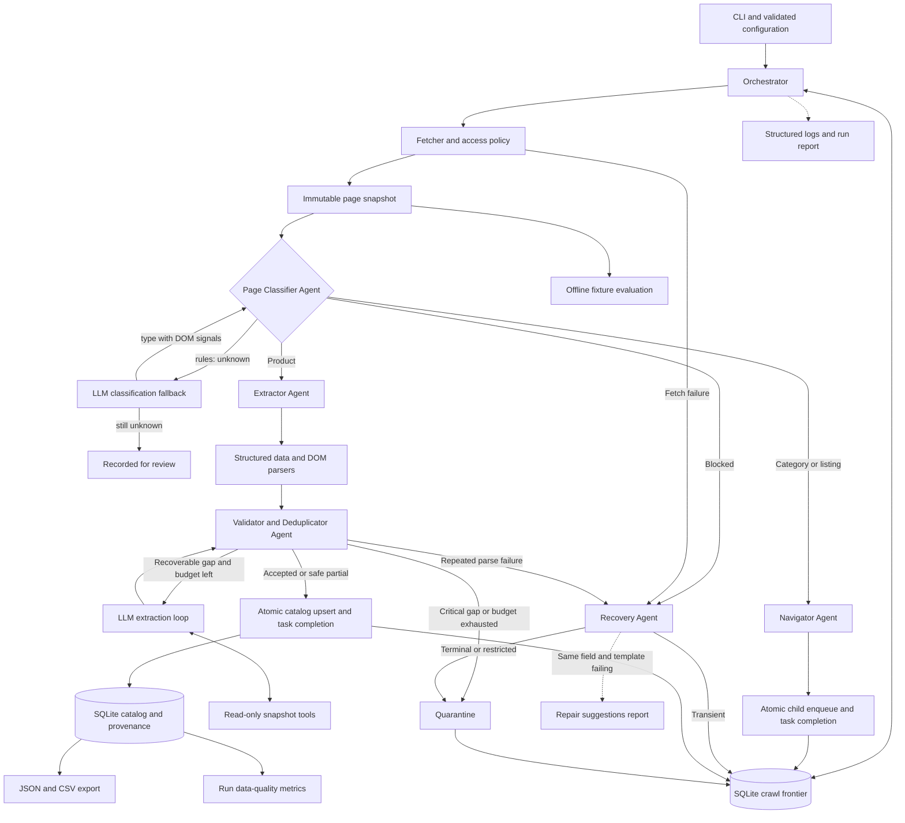
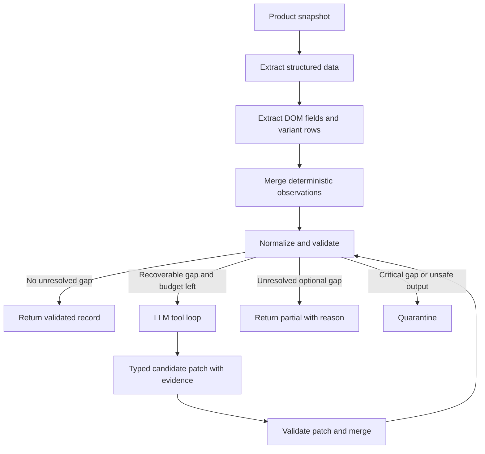
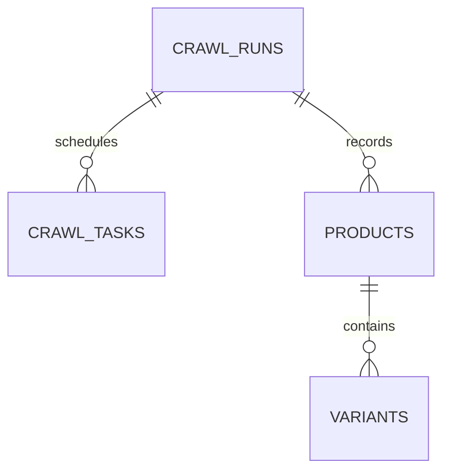
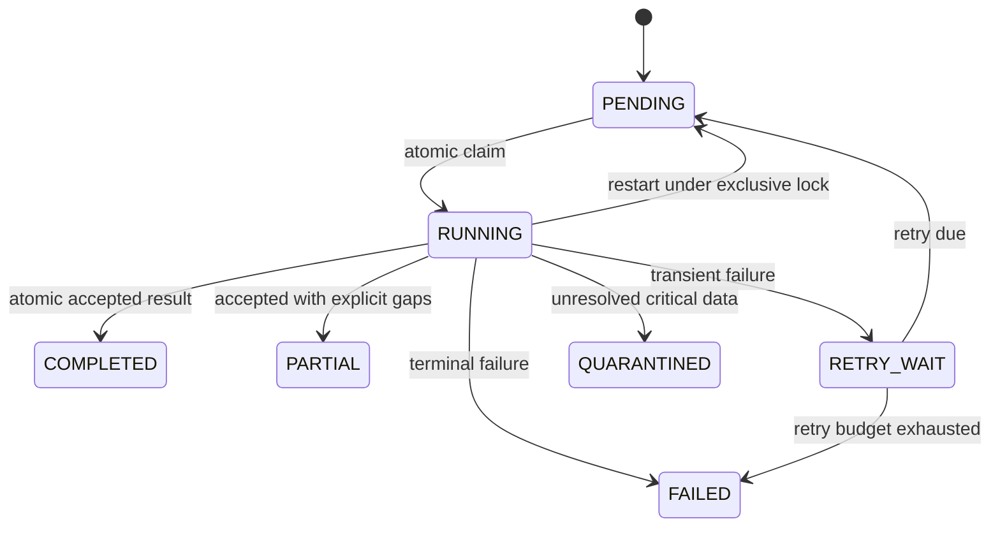

# CatalogAgent — Overall System Architecture

**Version:** 3.0 — Production-minded POC  
**Related:** [PRD](01-prd.md) · [Technical stack](02-technical-stack.md) · [Roadmap](04-roadmap.md)  
**Assumptions:** see [PRD §9](01-prd.md#9-assumptions-and-open-questions).

## 1. Architecture overview

CatalogAgent separates crawl execution from page-level intelligence. A deterministic Orchestrator schedules URLs, enforces access and resource policies and persists progress. Five agents each own one decision:

- **Navigator** — what to crawl next.
- **Page Classifier** — what kind of page this is.
- **Extractor** — what the product and its variants are.
- **Validator & Deduplicator** — whether the result is supported by the page and new.
- **Recovery** — what to do when something fails.

Each agent is rule-first and shares one typed contract ([Tech Stack §4](02-technical-stack.md#4-agent-roster)). The model is used where semantics are uncertain: irregular product layouts (Extractor), unrecognized pages (Classifier fallback) and repeated parse failures (Recovery repair suggestions). There is no LLM supervisor: the workflow is known in advance, so planning is not where a model adds value.



The POC runs as one active Python process per database with a small bounded async worker pool (sequential execution is acceptable at first). Frontier and catalog are logical stores in the same SQLite file, drawn separately to show responsibilities. Cleanup and retry counters are omitted from the diagram.

## 2. Component responsibilities

| Component | Input | Output | Responsibility |
|---|---|---|---|
| CLI / Config | Arguments, YAML, environment | Run configuration | Validate scope, limits, modes and model settings. |
| Orchestrator | Run configuration, frontier | Task dispatch and outcomes | Dispatch bounded workers, route results between agents, enforce budgets, finish the run. |
| Frontier | Run, URL and task metadata | Claimed task | Durable deduplicated tasks, atomic status transitions, retry schedule; exclusive process ownership. |
| Fetcher | Scoped URL, fetch policy | PageSnapshot or typed error | Browser rendering, timeouts, rate limiting, redirect checks. |
| Site adapter | Snapshot, source context | Source observations | URL patterns, selectors, pagination and metadata parsing for Safco. |
| **Page Classifier Agent** | Snapshot, expected type | Page type and reason | Rule-based classification; LLM fallback for `unknown` (P1). |
| **Navigator Agent** | Snapshot, category context | Links and pagination outcome | Discover subcategories and products, follow pagination, apply scope. |
| **Extractor Agent** | Product snapshot, validation gaps | Typed candidate or unresolved result | Deterministic parsers, then a bounded LLM tool loop for recoverable gaps. |
| Normalizer | Raw candidate | Canonical candidate | Identifiers, price, units, stock labels, attributes; raw values kept. |
| **Validator & Deduplicator Agent** | Candidate, original snapshot | Accept / partial / quarantine with issues | Schema, identity, evidence, variant coverage, consistency, dedup. |
| **Recovery Agent** | Typed error or repeated issue | Retry decision; repair suggestions | Classify failures, apply retry policy, propose and test selector repairs (P1). |
| Repository | Validated task outcome | Commit | Products, variants, provenance and task transitions in one transaction. |
| Exporter / Quality / Evaluation | Run records or fixtures | Dataset, metrics, report | Reproducible export, §10.1 metrics, baseline vs hybrid comparison. |

## 3. End-to-end execution

### 3.1 Initialize a run and discover categories

1. Load configuration, acquire exclusive database ownership and establish the permitted scope; check robots.txt and access rules before live requests.
2. Create a run ID and persist configuration, mode and start time. Insert a discovery task for the navigation or sitemap entry point.
3. Navigator extracts the category hierarchy. `selected` mode matches the two configured roots; `all` mode seeds every permitted discovered root. If discovery fails, the configured roots are used as explicit seeds and the run reports degraded discovery.
4. Links are canonicalized conservatively, keeping parameters needed for pagination or product identity. Unapproved hosts, unsafe schemes and off-scope links are rejected. Discovery provenance and parent category paths are recorded.

### 3.2 Claim and fetch a page

The Orchestrator assigns an eligible task in a short SQLite transaction, moving it from PENDING to RUNNING and incrementing its attempt count. A RUNNING task is never dispatched again while the process holds ownership. Database locks are released before network or model calls. The Fetcher applies host and scope rules, pacing, timeout and rendering. It waits for listing/product readiness signals rather than fixed sleeps, and distinguishes a loaded empty listing from a loading placeholder.

The resulting snapshot holds final URL, status, timestamp, content hash, relevant DOM/structured data and stable section/row IDs, and is immutable; a recrawl creates a new snapshot. Redirects are checked against allowed hosts and scope. Snapshots are kept only as needed for replay and evidence.

### 3.3 Classify and traverse navigation pages

The Classifier uses URL patterns, metadata and DOM signals. A page with both subcategories and product cards is navigational, and both are extracted. When rules return `unknown`, the P1 fallback makes one model call that picks a type from the closed enum and cites section IDs; the type is accepted only if the DOM signals that type requires are present. Otherwise the page is recorded for review.

Navigator collects in-scope subcategory and product URLs, pagination state and category relationships. A load-more or infinite-scroll interface without distinct URLs is represented by a stable task cursor, or processed as a bounded sequence within one task with its completion reason stored. Repeated content and cursor cycles are detected. A product discovered through two categories keeps both associations but is scheduled once per run.

New child tasks and the current task's completion are committed in one transaction, so a crash cannot mark a navigation task complete while losing its children.

### 3.4 Extract and validate a product page



The Extractor subgraph state holds a snapshot reference, raw observations, candidate product/variants, evidence index, validation issues, attempted strategies, model/tool counters and a deadline. Site-wide state stays outside the graph.

Deterministic extraction reads structured metadata and DOM evidence and keeps source row identity. The Validator identifies recoverable gaps — for example a visible SKU row missing from the candidate, unrecognized attribute text or conflicting values. A field that is simply not displayed does not trigger the model. Deterministic extraction merges the rendered variant table with the page's structured data (a rendered row always wins; structured data fills SKUs the table did not render), so the model is not needed for a SKU the rules can already see. When neither the site-specific table nor structured data yields a row (an unrecognised layout, e.g. after a redesign), a generic evidence path builds `page-rows` from repeated DOM elements that each show a price and an SKU-like code (or the single smallest such element on a one-variant page), with column labels from a header row when one exists; a product page with no parsed variant but such rows raises a `no_variants` gap. The model sees three sample rows and returns a row mapping (which cell is the item number, which the label); code applies it to every row. Every mapped row is verified as strictly as a table row: the SKU must equal a whole SKU-like cell of that row and the price must equal that row's first displayed price. Without generic rows there is no gap and no model call.

The model receives only relevant snapshot context, the gaps and the schema, and can call the three read-only extraction tools. It returns a typed patch; it cannot crawl, write to storage, run commands or change parser configuration. Instruction-like page text is ignored. The runtime enforces call, time and token limits and revalidates after each patch, stopping when the gap is resolved, no progress is made or a budget runs out.

### 3.5 Persist and export

Accepted product data, variants, category associations, provenance and the task outcome are stored in one transaction. Optional unsupported fields are null with a reason; unresolved critical identity or conflicting row association is quarantined. Partial records are marked as such. Existing variants are not deleted because a later crawl is incomplete.

When no pending, running or retry-scheduled tasks remain, the run is finalized. A drained frontier means traversal terminated, not that full-site coverage is verified. When a run budget is reached, unfinished tasks are kept and the run is marked `BUDGET_EXHAUSTED`. Exports follow [PRD §5](01-prd.md#5-catalog-data-contract): nested product JSON, variant-level CSV, a run report with the §10.1 metrics and a failed-task summary, all scoped to one run.

## 4. Evidence and quality gate

**POC scope: evidence covers SKU and price only.** These are the two fields where a wrong value does real harm (wrong item ordered, wrong cost) and where row misalignment is most likely. Each SKU and price carries an evidence reference into the original snapshot; the Validator resolves it against source data, never against text supplied by the model.

```json
{
  "field": "price",
  "snapshot_id": "s_77a1",
  "section_id": "variant-table",
  "row_id": "row-1",
  "raw_value": "$12.49",
  "normalized_value": "12.49",
  "method": "llm"
}
```

The format is defined once in [PRD §5.3](01-prd.md#53-evidence-reference) and used unchanged in SQLite, JSON and CSV. Only verified references are stored; a value that fails verification is rejected.

All other fields (pack, availability, attributes, description, images, alternatives) pass schema and business checks only. When the model supplies one of them, its path is added to the product's `llm_fields`, so consumers can tell schema-checked model values from deterministic ones. Evidence for these fields is P1. **Implemented (P1):** pack, availability and attribute values now carry evidence refs resolved against their own row; description, images and alternatives remain schema-checked only.

Quality gate rules:

- **Identity:** product name and canonical URL are valid; SKU is an observed source code, never generated.
- **Row alignment:** each price belongs to the evidence row of its SKU; substring matches alone do not establish this.
- **Value grounding (SKU, price):** evidence IDs resolve, raw values match, and only documented deterministic normalization is applied.
- **Completeness:** the extracted SKU set is compared with independently observed SKU rows or variant metadata; when the expected set is unknown, coverage is `unknown`.
- **Conflict handling:** deterministic values stand unless a correction is independently validated; a known value is never overwritten by an unsupported model value.
- **Schema/business checks:** types, nonnegative prices, supported currency, nullable fields and enums; ambiguous raw labels are kept rather than guessed.

Evidence checks reduce hallucination risk but cannot prove every semantic interpretation; a human-reviewed sample measures residual error.

**Repair suggestions (P1).** When the same field fails on the same page template `trigger_after_failures` times, the Recovery Agent gives the model the failing sections and the current selector. The model proposes up to three replacement selectors; `test_selector` runs each across the frozen failing snapshots and a passing control set, and suggestions are ranked by match rate without regressions. The output is a report entry (field, template, old selector, candidates, test results); parsers are never changed automatically (ADR-10).

## 5. Minimal physical data model



Four tables. `product_id` and `variant_id` are stable across runs (PRD §5.7); every stored row is additionally keyed by `run_id`, so the same product observed in two runs produces two rows with the same `product_id` and exports stay reproducible without a history subsystem. Variable attributes, category paths, alternatives, evidence references and missing-field reasons are JSON columns. Field definitions follow [PRD §5](01-prd.md#5-catalog-data-contract). A snapshot directory holds immutable evidence/fixtures; tasks record a relative path and content hash.

| Table | Key and purpose |
|---|---|
| `crawl_runs` | Run ID, config/mode, timestamps, status, termination reason, counters and quality metrics JSON. |
| `crawl_tasks` | Unique `(run_id, task_key)`; URL/cursor, type, category lineage JSON, status, attempts, next retry, snapshot metadata, last error. |
| `products` | Primary key `(run_id, product_id)`; PRD §5.1 fields. |
| `variants` | Primary key `(run_id, variant_id)`, unique `(run_id, product_id, sku)`, foreign key `(run_id, product_id)` → `products`; PRD §5.2 fields. |

A product discovered under a new category path has that lineage merged into its task and product record in the same transaction. A product may have zero observed variants; this is distinguished from incomplete extraction. A new crawl writes separate observations rather than overwriting a prior run.

## 6. Runtime reliability



**Execution semantics:** at least once. Repeated fetches after a crash are possible; unique keys and transactional upserts make accepted effects idempotent. Short writes, including claims, are serialized in the single process; database locks are never held during HTTP or model calls; a bounded SQLite busy timeout is set.

**Exclusive ownership and restart:** a nonblocking `flock` on the database-specific lock file is acquired before any crawl or resume mutation and held for the process lifetime; a second process fails fast. After acquiring it, only the selected run's RUNNING tasks are reconciled: requeued within the attempt budget, otherwise marked FAILED. On graceful shutdown the Orchestrator stops dispatching and awaits workers before releasing ownership. No leases, heartbeats or fencing in the POC.

Child URLs and navigation-task completion commit together; product/variant upserts and product-task completion commit together; failed commits roll back. Completed tasks are untouched on resume. Retry timestamps are persisted, Retry-After is honored, attempts are bounded, and budgets are reserved before dispatch (§6.1).

### 6.1 Budgets and resume

Budgets have two scopes, and resume treats them differently.

| Budget | Scope | Counts | On resume |
|---|---|---|---|
| `max_pages` | Run, cumulative | Fetch attempts, retries included (each attempt loads the host) | Continues from the persisted total |
| `max_products_per_category` | Run, cumulative | Accepted or partial products | Continues from the persisted total |
| `max_model_calls_per_run`, token limits | Run, cumulative | Model calls and tokens across all agents | Continues from the persisted total |
| `max_invocation_seconds` | One `crawl` or `resume` process | Wall-clock time | Starts fresh each invocation |
| Per-task model/tool/time limits | One task attempt | Calls and seconds within the attempt | Reset per attempt; the run-level caps bound the total |

Rules:

- **Persisted with the run.** Counters and limits live in `crawl_runs`. A resume uses the run's stored configuration; edits to the YAML file do not change scope or budgets of an existing run.
- **Reserved before use.** A page or model call is reserved before dispatch. A reservation held by a task that was interrupted counts as consumed, so a crash can never let a run exceed its limits.
- **Crash or `PAUSED`:** `resume --run-id` continues with the remaining budget.
- **`BUDGET_EXHAUSTED`:** a plain resume exits immediately with the same status. Explicit flags raise the cumulative limits: `resume --run-id RUN_ID --add-pages N --add-model-calls N`. Each extension is recorded in `crawl_runs` with its timestamp and appears in the run report.
- **Time limit reached:** the run is marked `PAUSED` (not `BUDGET_EXHAUSTED`), because a fresh invocation can continue without extending anything.

### 6.2 Failure handling

| Failure | Recovery Agent handling |
|---|---|
| Timeout, connection error, selected 5xx | Bounded exponential backoff with jitter; logged. |
| 429 / throttling | Honor Retry-After; slow or pause the host within the run budget. |
| 401, 403, CAPTCHA, explicit restriction | Stop or pause the affected scope; no circumvention. |
| 404 or unsupported page | Terminal outcome or review entry; no indefinite retry. |
| Incomplete rendering | Bounded readiness retry on page signals. |
| Missing supported fields | Extractor fallback where useful; revalidate. |
| Same field failing repeatedly on one template | Repair suggestion (P1); affected records stay partial. |
| Model timeout, invalid output, missing key | Bounded retry; record degraded recovery; keep verified fields. |
| Ambiguous SKU or unsupported critical value | Quarantine with evidence. |
| Database failure | Roll back; recover the task after ownership is re-established. |

## 7. Observability and POC evaluation

Every event includes `run_id`, `task_id`, `agent`, `event`, timestamp, strategy and outcome, plus duration and error code. Model events add model ID, tool names, token usage and cost. Credentials and full prompts are not logged by default.

The run report separates discovered URLs, unique products, accepted/partial/quarantined/failed pages, outstanding tasks, observed SKUs, retries, fallback reasons, extraction duration and the §10.1 metrics.

Evaluation replays the same frozen fixtures in `deterministic` and `hybrid` modes against manually checked references, including irregular layouts and missing fields. It measures field correctness, variant precision/recall, completeness, fallback and recovery success, latency, model calls and cost, on a held-out set where feasible. Fixture results are reported as replay results, not full-site accuracy.

## 8. Full-site scaling

### 8.1 Same code path, wider scope

`selected` and `all` differ only in root selection; scheduler, discovery, dedup, pagination, extraction and persistence are identical. `all` still enforces authorization and finite budgets.

In the POC, `all` is a configuration switch rather than a separately tested mode. Because it reuses the exact path that the two-category live run exercises, the only new logic is root selection, which a unit test checks against the saved navigation snapshot. No dedicated multi-root fixture is built (P2). The README documents:

- what `scope: all` does (seeds every permitted root found in navigation, then the same traversal);
- which budgets bound it (`max_pages`, `max_model_calls_per_run`, `max_invocation_seconds`; §6.1) and that a budget stop leaves resumable work;
- what was verified (two live categories, root-selection unit test) and what was not (a full live crawl, multi-root traversal end to end).

Run status is one of `COMPLETED`, `COMPLETED_WITH_ERRORS`, `BUDGET_EXHAUSTED`, `PAUSED`, `FAILED`, with coverage status `partial` or `unknown`.

### 8.2 Sizing model

The binding constraint for one supplier is the polite per-host request rate, not compute:

```
crawl_hours ≈ (N_listing + N_product) × (1 + retry_rate) / request_rate / 3600
llm_calls   ≈ N_product × fallback_rate × calls_per_fallback
```

Worked example with placeholder inputs (A-10; replaced with M0/M4 measurements): 300 listing pages, 6,000 product pages, 5% retries, one navigation every 2 s (0.5 req/s) → (6,300 × 1.05) / 0.5 ≈ 13,200 s ≈ **3.7 hours**. With a 10% fallback rate and ≤3 calls per fallback, ≤1,800 model calls per full crawl.

Implications:

- A full Safco crawl is a few-hour nightly job on **one worker**. Adding workers for one host does not help, because they share the same rate budget.
- Horizontal scaling pays off across **multiple sources** (one rate budget per host) and for browser rendering if render time, not pacing, becomes the bottleneck.
- Recrawl cost drops sharply with incremental crawling: sitemap `lastmod` or listing-level content hashes select which product pages to refetch.

### 8.3 Steps from POC to full site

1. Seed `all` permitted roots from navigation or sitemap; keep finite run budgets and checkpointed resume.
2. Run nightly with `BUDGET_EXHAUSTED` resumption across windows if a run exceeds its time budget.
3. Add incremental recrawl and change detection (price, availability, SKU set).
4. Move to the Stage 1 deployment below; add workers only when a second source is onboarded.

## 9. Deployment path

| Stage | Runtime | State | Secrets | Observability | Trigger |
|---|---|---|---|---|---|
| **0 — POC** | Local CLI (`uv run catalog-agent …`) | SQLite + local snapshot dir | `.env` (git-ignored) | JSON logs, `run_report.json` | Now |
| **1 — Scheduled job** | Docker image on the official Playwright Python base, run as a scheduled container job (AWS ECS Scheduled Task on Fargate, or GCP Cloud Run Jobs) | Managed PostgreSQL (RDS / Cloud SQL); snapshots in S3 / GCS with lifecycle retention | AWS Secrets Manager / GCP Secret Manager, injected as environment variables | Cloud logging of JSON logs; §10.2 metrics as custom metrics with alerts | Recurring crawls are needed |
| **2 — Multi-source** | Queue (SQS / Pub/Sub) + horizontally scaled workers with fenced leases | PostgreSQL task claims; shared per-host token bucket (e.g. Redis) | Same, per-source credentials scoped by IAM | OpenTelemetry traces, dashboards, on-call alerts | A second source or per-host parallelism is needed |

Release process from Stage 1:

- **CI** (e.g. GitHub Actions): Ruff, pytest and fixture replay on every pull request; image build and push on merge.
- **Adapter changes** (including applied repair suggestions) must pass the fixture regression set before merge.
- **Canary:** a new image first runs one category; it is promoted to the full scope only if §10.2 metrics stay within thresholds.
- **Rollback:** redeploy the previous image tag; run-scoped data means a bad run is excluded from exports rather than repaired in place.

## 10. Production data-quality monitoring

The POC and production measure different things. One POC run has no history to compare against, so it reports absolute values; production compares each run with recent runs, because most failures show up as a change rather than as an error.

### 10.1 POC run metrics (implemented, reported in `run_report.json`)

Computed from a single run, reported per category, with no alerting. They show reviewers the quality of the delivered sample and become the baseline for §10.2.

| Metric | Computed as |
|---|---|
| Field fill rate | Non-null rate per field, per category |
| Validation failure rate | Product pages with schema or evidence issues / product pages |
| Quarantine rate | Quarantined / product pages |
| LLM fallback rate | Product pages that used the model / product pages |
| Evidence rejection rate | Rejected model patches / model patches |
| Duplicate identity count | SKUs that appear under more than one product |
| Missing-reason distribution | Count of each PRD §5.4 reason, per field |

### 10.2 Production monitoring (design only)

Built at Stage 1 (§9). Runs are compared with history and alerts route to the owning engineer. Thresholds are starting points, tuned after a baseline of runs.

| Metric | Computed as | Alert when | Usually means |
|---|---|---|---|
| Field fill-rate drift | §10.1 fill rate vs median of last 7 runs | Drops > 10 points | Layout change or broken selector |
| SKU count change | Accepted SKUs per category vs previous run | Changes > ±15% | Pagination break, scope bug or real catalog change (review) |
| Price anomalies | Per-SKU price change between runs | > 50% change, or price → null | Parsing error or real price change; held for review, not auto-published |
| Validation failure rate | As §10.1 | > 2% | Parser regression |
| Quarantine rate | As §10.1 | > 5% | Identity or row-alignment problem |
| LLM fallback rate | As §10.1, vs trailing baseline | > 2× baseline | Layout drift; also triggers repair suggestions |
| Evidence rejection rate | As §10.1 | > 20% | Model or prompt regression |
| Duplicate identity count | As §10.1 | > 0 | Identity rule bug |
| Freshness | Age of last accepted observation per category | > 48 h | Failed or stalled scheduled runs |
| Sampled accuracy | Human check of 20 random SKUs per week | Precision < 98% on critical fields | Silent semantic errors that automated checks miss |

Runs that breach a critical threshold are marked `COMPLETED_WITH_ERRORS` and excluded from downstream publication until reviewed.

### Production evolution summary

| POC | Production |
|---|---|
| Single process, SQLite frontier | PostgreSQL task claims and leases; distributed workers when justified |
| In-process host pacing | Shared host rate budgets and backpressure |
| Local snapshots | Object storage with retention and integrity metadata |
| JSON logs and run report | OpenTelemetry, centralized logs, dashboards, alerting on §10.2 metrics |
| Manual run/resume | Scheduled recrawls, incremental comparison, versioned observations |
| One Safco adapter | Versioned per-source adapters, contract tests, canary rollout |
| Repair suggestions report | Reviewed suggestion → PR → fixture regression → canary |
| `.env` configuration | Managed secrets, deployment automation, central model cost budgets |
