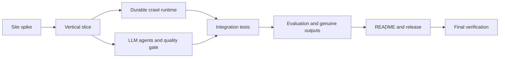

# CatalogAgent — 24-Hour Implementation Roadmap

**Version:** 3.0 — Production-minded POC  
**Constraint:** At most 24 hours of work, per the Frontier Dental assessment.  
**Principle:** Deliver a genuine, reproducible vertical slice before optimizing architecture or adding optional features.  
**Assumptions:** see [PRD §9](01-prd.md#9-assumptions-and-open-questions). Timeboxes are planning estimates; actual effort is tracked and scope stops at the limit.

## 1. Delivery milestones

| Timebox | Milestone | Work | Exit criteria |
|---|---|---|---|
| 0–3 h | M0 — Site spike | Check robots.txt and terms; inspect navigation, DOM, network calls, structured data, pagination and variants; resolve A-02…A-06; save representative fixtures; basic Playwright fetch. | One real product page captured per root; crawl strategy chosen; PRD §9 updated with outcomes; field mapping to PRD §5. |
| 3–8 h | M1 — Vertical slice | CLI/config, Safco adapter, Navigator and Classifier rules, deterministic Extractor; small bounded sample. | At least one real product per category reaches typed storage and JSON export with variant data. |
| 8–11 h | M2 — Durable runtime | SQLite frontier/catalog, exclusive lock, transactional enqueue/commit, dedup, restart recovery, Recovery Agent retry policy, pacing. | Resume test passes; repeated task creates no duplicates; pagination/dynamic loading works. |
| 11–14 h | M3 — LLM agents and quality gate | Normalizer, SKU/price evidence, `llm_fields` tagging, Validator issues, LangGraph Extractor loop, read-only tools, budgets, partial/quarantine. P1 if on schedule: Classifier fallback, repair suggestions. | One reproducible fallback case passes through the model and independent validation; an unsupported candidate is rejected; deterministic mode still works. |
| 14–18 h | M4 — Robustness and evaluation | Root-selection unit test for `all`, crash/resume, limits, access policy; §10.1 POC metrics in run report; baseline vs hybrid on a checked sample if time permits. | Core tests pass or failures are disclosed; evaluation reports denominators, outcomes, failures and model use. |
| 18–22 h | M5 — Submission artifacts | Genuine two-category output, CSV/JSON, run report, README per §7, clean setup check. | A reviewer can run the documented commands and inspect a real dataset with no unstated steps. |
| 22–24 h | M6 — Verification and buffer | Re-run smoke tests, inspect sample records against the site, remove secrets, check Git status; short demo if time permits. | P0 checklist complete or gaps disclosed in the README. |

## 2. Dependency order and priority



### P0 — Required submission

- [ ] Confirm permitted access and set a scoped crawl configuration.
- [ ] Discover both category roots and traverse descendants/listings.
- [ ] Handle the site's dynamic content or pagination; report the stopping reason.
- [ ] Extract product fields and every observed SKU variant from both categories.
- [ ] Normalize and validate to the PRD §5 schema; preserve missing-field reasons.
- [ ] Navigator, Classifier, Extractor and Validator implemented as separate agents behind the common contract; LLM-assisted extraction with typed output, SKU/price evidence checks, `llm_fields` tagging and bounded calls.
- [ ] Persist tasks and catalog; exclusive single-process ownership, resume, retries, rate limiting, atomic completion and idempotent upserts.
- [ ] Implement the `selected`/`all` switch with a root-selection unit test; record termination reasons; explain `all` in the README (Architecture §8.1).
- [ ] P0 test suite (§3.1) passing.
- [ ] Export genuine JSON and CSV samples and a run report including the §10.1 POC quality metrics.
- [ ] Clean Git repository, secret-free configuration and a README covering every item in §7.

### P1 — Competitive differentiators

- [ ] Classifier LLM fallback for `unknown` pages (FR-11).
- [ ] Recovery Agent repair suggestions with `test_selector` verification (FR-12).
- [ ] Evidence references for pack, availability and attributes.
- [ ] A second recovery case with typed validation feedback; recovery success measured.
- [ ] Offline deterministic-vs-hybrid evaluation on manually checked fixtures (FR-13).
- [ ] Adversarial/malformed extraction tests.
- [ ] Short demo of the real crawl, recovery, evidence and measured AI value.

### P2 — Production evolution (documentation only)

- Multi-root fixture graph verifying `all` scope end to end.
- Distributed workers, fenced leases and heartbeats, PostgreSQL migration.
- Large-scale capacity testing, automatic selector rollout, incremental crawling, centralized telemetry.
- No dashboard or extra agent hierarchy. Docker packaging only after P0/P1 and clean setup.

If the schedule slips, cut in this order: P1 items, test sample size, secondary parser strategies. Genuine two-category data, variant correctness, basic reliability and clear limitations are never cut.

## 3. Verification plan

The P0 suite is small on purpose: five test files plus one smoke script, all running offline in well under a minute. Each file covers several scenarios against saved fixtures and fake fetch/model tools; none of them load the live site.

### 3.1 P0 test suite

| File | Scenarios covered | Key assertions |
|---|---|---|
| `test_discovery.py` | Navigation with children, duplicate and off-scope links; pagination/delayed container; root selection | In-scope links scheduled once with hierarchy; off-scope rejected; pagination stop reason recorded; `selected` seeds exactly the two configured roots and `all` seeds every permitted root on the saved navigation snapshot. |
| `test_extraction.py` | Multiple SKU rows; no visible price; export shape | Distinct variants with row-correct price/pack; price null with `not_visible` or `login_required`; one product round-trips to JSON and CSV per PRD §5 (same values, `evidence` present for SKU/price). |
| `test_agent_loop.py` | Fake model returns (a) a valid patch, (b) a price/SKU not in the evidence row, (c) no progress, (d) output influenced by instruction-like page text | (a) accepted and listed in `llm_fields`; (b) rejected, verified values kept or record quarantined; (c) stops at budget, partial or quarantine; (d) tools expose no URL/filesystem/database access and output is still validated. |
| `test_persistence.py` | Same task twice; failure injected before commit; interrupt with active and pending tasks; second process on the same database; same product in two runs | Unique counts unchanged; nothing partially committed; completed tasks untouched and interrupted ones recovered only after lock acquisition; second process fails fast; two runs keep separate rows for the same `product_id`. |
| `test_runtime.py` | Simulated 429/Retry-After and 403; small `max_pages`; resume with and without `--add-pages` | Backoff/pause, no bypass; `BUDGET_EXHAUSTED` with pending tasks kept; plain resume stops immediately, extended resume continues within the new limit (Architecture §6.1). |
| `scripts/smoke.sh` | Fresh environment, fixture replay | README commands run end to end and produce parseable, run-scoped outputs. |

### 3.2 P1 tests

| File | Scenario | Expected behavior |
|---|---|---|
| `test_classifier_fallback.py` | Unrecognized layout; model answer lacking the required DOM signals | First page routed correctly; second recorded for review, not routed. |
| `test_repair_suggestions.py` | Selector that no longer matches | Suggestion produced and tested by `test_selector` on failing and control snapshots; parser config unchanged. |
| `test_adversarial.py` | Malformed model output, oversized tool results, cursor cycles | Rejected or bounded without crashing the run. |

Isolated fixtures and injected failures are used for deterministic tests, plus a limited live smoke test where permitted. The README reports the tests actually run.

## 4. Evaluation plan

Two modes on identical saved page inputs:

- **Baseline:** deterministic structured-data and DOM extraction, no model calls.
- **Hybrid:** the same baseline plus conditional LLM recovery and the same independent quality gate.

Sample: 10–20 manually reviewed product pages across both categories, including ordinary and irregular examples, with parser-development and held-out pages separated where possible. If fewer can be reviewed in time, the exact sample size is reported rather than weakening label quality.

| Metric | Definition |
|---|---|
| Field accuracy | Correct predicted values / predicted values assessed; normalized equivalence documented. |
| Field completeness | Correctly populated fields / eligible expected fields (definition stated); distinct from accuracy. |
| Variant recall | Correctly matched SKUs / reference SKUs. |
| Variant precision | Correctly matched SKUs / predicted SKUs. |
| Recovery success | Resolved, validated recovery cases / attempted cases. |
| Unsupported field rate | Unsupported accepted values / accepted values audited. |
| Model usage | Model calls, tokens and fallback rate across product pages. |
| Latency and cost | Measured per-page duration; cost from actual usage and published rates. |

Zero denominators are reported as not applicable. Results are broken down by category and mode, including missed, extra and incorrect fields. A hybrid result that is slower, costlier or no more accurate is a valid finding and is reported as such. Live and replay results are kept separate.

## 5. Risk register

| Risk | Mitigation / decision |
|---|---|
| Access denied or terms prohibit crawling | Stop live operations; document the blocker; use permitted fixtures only for a clearly labeled partial demonstration. |
| Dynamic content more complex than expected | One working loading path and a small genuine sample; unsupported patterns documented. |
| Prices hidden behind sign-in | Record `price_visibility = login_required`; never sign in or bypass. |
| Ambiguous variant identifiers | Keep raw labels and evidence; quarantine instead of generating codes. |
| LLM does not improve results | Keep fallback selective; report measured results; show a controlled irregular-layout fixture separately from live results. |
| Model API unavailable | Deterministic mode keeps working; README states which LLM behavior was not demonstrated. |
| LangGraph slows M3 | Swap the graph for a plain async loop behind the same `ExtractorAgent` interface (ADR-09). |
| SQLite contention | Short transactions, serialized writes; reduce concurrency before adding infrastructure. |
| Time overrun | Freeze P1/P2 immediately; protect P0 and genuine output. |
| Layout changes during the demo | Replay saved fixtures; label replay versus live behavior. |

## 6. Final submission package

```text
README.md                         # see §7
configs/safco.yaml                # validated scope and budgets
src/                              # implementation
pyproject.toml / uv.lock          # reproducible dependencies
.env.example                      # variable names only
tests/                            # fixtures and automated tests
outputs/products.json             # genuine accepted sample, both categories (PRD §5.6)
outputs/variants.csv              # variant-level export (PRD §5.6)
outputs/run_report.json           # measured outcomes and §10.1 POC quality metrics
outputs/evaluation_report.json    # baseline vs hybrid, if completed
outputs/repair_suggestions.json   # if FR-12 completed
outputs/failed_tasks.json         # failure reasons, no sensitive content
docs/                             # PRD, technical stack, architecture, roadmap
```

A database dump is included only if useful and safe to share. Outputs are scoped to the sample run. If raw fixtures cannot be shared, sanitized or synthetic fixtures are used and labeled; synthetic data is never presented as scraped output.

## 7. Final README outline

The README is what the reviewer reads first, so it answers every assignment item directly and links to the design docs for depth. Sections in order, with the assignment item each one answers:

| README section | Answers assignment item | Source in docs |
|---|---|---|
| 1. Overview and results at a glance | — (headline: products, SKUs, categories, tests passed, LLM usage from the real run) | `run_report.json` |
| 2. Architecture overview | B: Architecture overview | Architecture §1 diagram |
| 3. Why this approach | B: Why you chose your approach | Tech Stack §3 ADRs (summarized) |
| 4. Agent responsibilities | B: Agent responsibilities | Tech Stack §4 roster table |
| 5. Setup and execution | B: Setup & execution; minimum bar: setup & workflow instructions | Tech Stack §7 commands, as actually tested |
| 6. Output schema and samples | B: Sample output schema; C: Output sample; 2) schema clearly documented | PRD §5 tables + links to `outputs/` |
| 7. Production-minded controls | 4) rate limiting, retries, errors, resumability, logging, dedup, idempotency, config, secrets | Architecture §6, Tech Stack §5 |
| 8. Failure handling | B: Failure handling | Architecture §6 failure table |
| 9. Where AI adds value (measured) | "use AI/agents where they add value" | Evaluation report, fallback stats |
| 10. Scaling to full-site crawling | B: How you would scale to full-site crawling | Architecture §8.1 `all`-scope explanation (what it does, its budgets, what was and was not verified), §8.2 sizing with measured inputs, §9 deployment path |
| 11. Data-quality monitoring | B: How you would monitor data quality | Architecture §10.1 (what the POC measures now) and §10.2 (production monitoring and alerts) |
| 12. Limitations | B: Limitations; minimum bar: notes on current limitations | Actual gaps, PRD §9 outcomes |
| 13. Tests | — (tests actually run and their results) | `pytest` output |

## 8. Reviewer demonstration (optional, about five minutes)

| Segment | Demonstration |
|---|---|
| 0:00–0:45 | Problem, the five agents and where the model is used. |
| 0:45–1:45 | Bounded live crawl if permitted, or a labeled recorded run and replay. |
| 1:45–2:30 | Product and SKU records, provenance and missing-field reasons. |
| 2:30–3:15 | Irregular fixture: Extractor tool calls and the quality gate. |
| 3:15–4:00 | Interrupt/resume, budget extension and deduplicated data. |
| 4:00–5:00 | Measured evaluation, quality metrics, trade-offs, limitations and scaling plan. |

## 9. Post-POC roadmap (outside the 24-hour delivery)

1. Confirm site authorization, crawl coverage, identifier semantics and data retention.
2. Expand adapter coverage and collect more independently checked evaluation samples.
3. Scheduled recrawls, versioned observations, change detection and §10.2 alerting.
4. PostgreSQL and controlled concurrent workers with fenced leases when a second source justifies it; central host and model budgets.
5. Object storage, managed secrets, telemetry and the reviewed repair-suggestion → PR → canary flow.
6. Data-quality service objectives, human review workflow and cost/performance regression gates.

Before submission, milestone status and proposed metrics in this document are replaced with actual observations.
